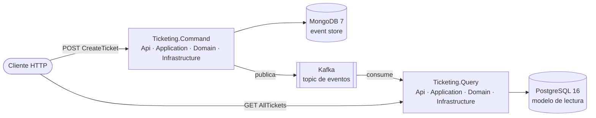

# Microservices-Events — Ticketing

Dos **microservicios independientes** en **.NET 10**, `Ticketing.Command` (escritura) y `Ticketing.Query`
(lectura), cada uno con su base de datos y su *composition root*, comunicados por eventos en **Kafka**. Es un
proyecto de aprendizaje independiente del monolito, con su propia solución y su propio Docker.

Qué se practica con código que funciona:

- **CQRS a nivel de servicio:** escritura y consulta son servicios distintos, sin llamarse ni compartir base de
  datos. Solo comparten el contrato `Ticketing.Common`.
- **Event Sourcing (en `Command`):** el estado de un ticket es el resultado de reproducir sus eventos, guardados
  en un *event store* de MongoDB.
- **Clean Architecture** en cada servicio (Api, Application, Domain, Infrastructure).
- **Transacciones en MongoDB** (replica set) tras un Unit of Work.
- **Kafka:** cada evento guardado se publica y `Query` lo proyecta en PostgreSQL.
- **Pipeline de MediatR (en `Command`):** validación solo para peticiones marcadas con `IValidatableRequest`,
  registro con nivel según el resultado y un middleware que convierte excepciones en `Response<T>` (400 / 500).

## Los dos microservicios

| | `Ticketing.Command` | `Ticketing.Query` |
|---|---|---|
| Rol | Recibe órdenes y las convierte en eventos | Sirve consultas sobre un modelo relacional |
| Almacén | MongoDB 7 (event store, replica set) | PostgreSQL 16 con EF Core |
| Endpoint | `POST api/v1/TicketCreate/CreateTicket` | `GET api/v1/Ticket/AllTickets` |
| Con Kafka | Publica cada evento guardado | Consume el topic y proyecta |
| Estado | `CreateTicket` completo, con validación, middleware de excepciones y tests unitarios | Consumidor y proyección escritos, sin probar de extremo a extremo; migración `Initial` por regenerar |
| Docs | [Arquitectura](docs/command/arquitectura.md) | [Arquitectura](docs/query/arquitectura.md) · [Consumidor](docs/query/consumidor-kafka.md) |



Qué se comparte y qué no, en [*Arquitectura general*](docs/arquitectura.md).

## Estructura

```
Microservices-Events/
├── Docker/docker-compose.yml          MongoDB (rs0), Zookeeper, Kafka, Kafka UI y PostgreSQL
├── docs/                              Documentación (command/ y query/ por servicio)
└── Ticketing/
    ├── Ticketing.slnx
    ├── Ticketing.Core/Ticketing.Common/   Contrato compartido: Message, eventos, eEventType, KafkaTopics, Response<T>, IEventProducer
    ├── Ticketing.Command/             Api · Application · Domain · Infrastructure · UnitTest
    └── Ticketing.Query/               Api · Application · Domain · Infrastructure · UnitTest
```

## Documentación

| Documento | Qué cuenta |
|---|---|
| [Arquitectura general](docs/arquitectura.md) | Qué es independiente, qué se comparte y cómo se comunican |
| [Decisiones generales](docs/decisiones-tecnicas.md) | Independencia, una BD por servicio, Kafka, topic y `eEventType` |
| [Mensajería con Kafka](docs/mensajeria-kafka.md) | Compose, listeners, productor, cuándo se publica y limitaciones |
| [Entorno local](docs/entorno-local.md) | Levantar la infraestructura y los servicios, probar, tests y CI |
| **Command** · [Arquitectura](docs/command/arquitectura.md) | Proyectos, arranque, DI, recorrido de una petición y tests |
| **Command** · [Agregados](docs/command/agregados.md) | El ticket como agregado inmutable y sus versiones |
| **Command** · [Event store](docs/command/event-store.md) | Guardado, concurrencia, mapeo a MongoDB y cómo añadir un evento |
| **Command** · [Decisiones](docs/command/decisiones-tecnicas.md) | Replica set, UoW, agregado, concurrencia, pipeline y middleware |
| **Query** · [Arquitectura](docs/query/arquitectura.md) | Proyectos, modelo de datos, migraciones y pendientes |
| **Query** · [Consumidor de Kafka](docs/query/consumidor-kafka.md) | Recorrido de un evento hasta PostgreSQL, qué falta y cómo probarlo |
| **Query** · [Decisiones](docs/query/decisiones-tecnicas.md) | EF Core, `IHostedService`, commit manual, scope por mensaje |

## Stack

.NET 10 · ASP.NET Core · MongoDB 7 (`MongoDB.Driver` 3.12) · Kafka 3.7 (`Confluent.Kafka` 2.16) · PostgreSQL 16 +
EF Core 10 · MediatR 14 · FluentValidation 12 · Asp.Versioning 10 · Swashbuckle 10 · xUnit.

## Puesta en marcha rápida

```bash
docker compose -f Microservices-Events/Docker/docker-compose.yml up -d
dotnet run --project Microservices-Events/Ticketing/Ticketing.Command/Ticketing.Command.Api
dotnet run --project Microservices-Events/Ticketing/Ticketing.Query/Ticketing.Query.Api
```

Los servicios se arrancan por separado. `Command` necesita MongoDB *healthy* y Kafka; `Query` necesita
PostgreSQL (con su cadena de conexión), Kafka, un empleado cargado y el topic creado por `Command`. Detalles en
[*Entorno local*](docs/entorno-local.md).
