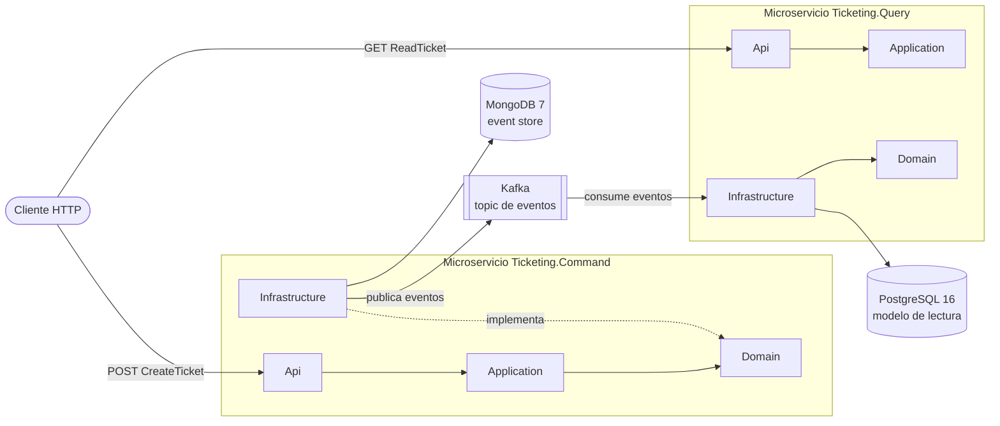
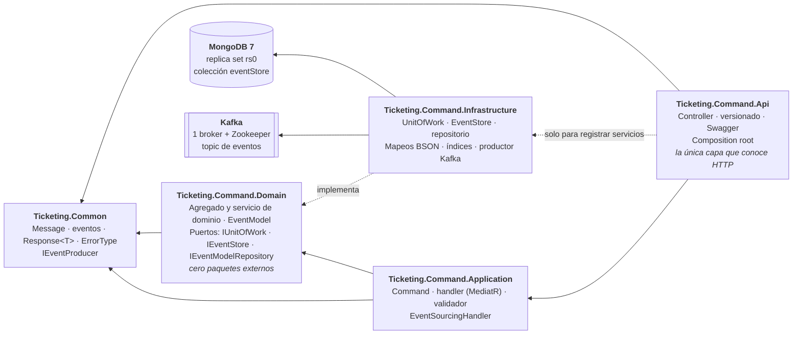
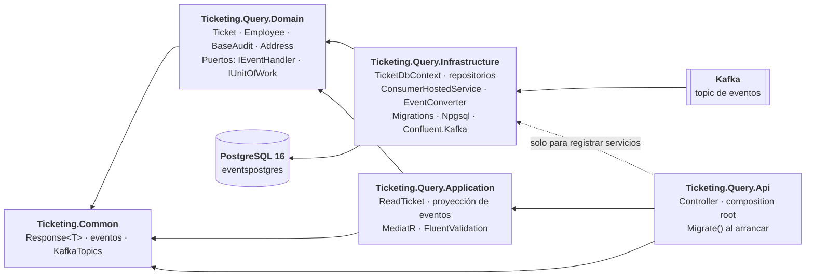

# Microservices-Events — Ticketing

Dos **microservicios independientes** en **.NET 10**, `Ticketing.Command` (escritura) y `Ticketing.Query`
(lectura), cada uno con su propia base de datos y su propio *composition root*, comunicados por eventos en
**Kafka**. Es un proyecto de aprendizaje independiente del monolito: no forma parte de la migración Strangler
Fig, tiene su propia solución y su propio Docker.

El objetivo no es la cantidad de funcionalidad sino entender, con código que funciona, ideas que suelen
explicarse solo en teoría:

- **Microservicios independientes:** `Command` y `Query` tienen sus propios proyectos, su propio almacén
  (MongoDB y PostgreSQL) y puertos distintos; no se llaman entre sí ni comparten base de datos. Lo único que
  comparten en código es el contrato `Ticketing.Common`.
- **CQRS a nivel de servicio:** el lado de escritura y el de consulta son servicios distintos, no dos
  capas de una misma aplicación.
- **Event Sourcing (en `Command`):** el estado no se guarda como una fila que se modifica, sino como una
  secuencia de eventos inmutables en un *event store*. El estado de un ticket es el resultado de reproducir
  sus eventos.
- **Clean Architecture en cada servicio:** Api, Application, Domain e Infrastructure, con las dependencias
  siempre hacia dentro.
- **Transacciones en MongoDB:** sesiones y transacciones sobre un replica set, aisladas tras un Unit of
  Work para que la capa de aplicación no conozca el driver.
- **Mensajería con Kafka:** cada evento guardado se publica en un topic y `Query` lo consume para proyectarlo
  en PostgreSQL (la **proyección** del modelo de lectura). El consumidor está escrito, pero el flujo completo
  aún no se ha probado de extremo a extremo.

## Los dos microservicios

| | `Ticketing.Command` | `Ticketing.Query` |
|---|---|---|
| Rol | Escritura: recibe órdenes y las convierte en eventos | Lectura: sirve consultas sobre un modelo relacional |
| Almacén | MongoDB 7 (event store, replica set de un nodo) | PostgreSQL 16 con EF Core |
| Endpoint | `POST api/v1/TicketCreate/CreateTicket` | `GET api/v1/TicketCreate/ReadTicket` |
| Con Kafka | Publica cada evento guardado | Consumidor: lee el topic y proyecta cada evento en PostgreSQL |
| Estado | `CreateTicket` completo, con transacción y publicación en Kafka | Consumidor y proyección escritos, sin probar de extremo a extremo; `ReadTicket` sin implementar; migración `Initial` por regenerar |
| Documentación | [Arquitectura](docs/command/arquitectura.md) | [Arquitectura](docs/query/arquitectura.md) · [Consumidor](docs/query/consumidor-kafka.md) |

Más: `Ticketing.Common` (contrato compartido: `Message`, `EventBase`, eventos, `eEventType`, `KafkaTopics`,
`Response<T>`, `ErrorType`, `IEventProducer`), Docker (MongoDB, Zookeeper, Kafka, Kafka UI y PostgreSQL) y CI
(`ci-micro-events.yaml`: restaura, compila y ejecuta el proyecto de tests).

## Arquitectura

### Visión general



Qué es independiente y qué se comparte (con los acoplamientos que existen hoy), en
[*Arquitectura general*](docs/arquitectura.md).

### Ticketing.Command



`Ticketing.Command.Domain` no tiene un solo `PackageReference`: los puertos viven ahí, en quien los *usa*, e
`Infrastructure` los implementa con el driver de MongoDB. Los componentes uno a uno, con el recorrido de la
petición, están en [*Arquitectura de Command*](docs/command/arquitectura.md#vista-de-componentes).

### Ticketing.Query



Estructura, modelo de datos y migraciones en [*Arquitectura de Query*](docs/query/arquitectura.md); cómo llega
un evento hasta PostgreSQL, en [*El consumidor de Kafka*](docs/query/consumidor-kafka.md).

## Estructura

```
Microservices-Events/
├── Docker/docker-compose.yml          MongoDB (replica set rs0), Zookeeper, Kafka, Kafka UI y PostgreSQL
├── docs/                              Documentación (ver tabla siguiente)
│   ├── command/                       Documentación de Ticketing.Command
│   └── query/                         Documentación de Ticketing.Query
└── Ticketing/
    ├── Ticketing.slnx
    ├── Ticketing.Core/
    │   └── Ticketing.Common/          Contrato compartido: Message, EventBase, eventos, eEventType, KafkaTopics, Response<T>, ErrorType, IEventProducer
    ├── Ticketing.Command/             Microservicio de escritura
    │   ├── Ticketing.Command.Api/             Controllers, versionado, Swagger, composition root
    │   ├── Ticketing.Command.Application/     Command, handler y validador (MediatR); EventSourcingHandler
    │   ├── Ticketing.Command.Domain/          Agregados y su servicio, EventModel, enums, excepciones, puertos
    │   ├── Ticketing.Command.Infrastructure/  MongoDB: contexto, sesión, UoW, repositorio, EventStore, mapeos, índices; productor de Kafka
    │   └── Ticketing.Command.UnitTest/
    └── Ticketing.Query/               Microservicio de lectura
        ├── Ticketing.Query.Api/             Controller, versionado, composition root; Migrate() al arrancar
        ├── Ticketing.Query.Application/     ReadTicket y proyección de eventos (MediatR, FluentValidation), EventHandler
        ├── Ticketing.Query.Domain/          Entidades, BaseAudit, value object Address y puertos
        ├── Ticketing.Query.Infrastructure/  TicketDbContext, repositorios, consumidor de Kafka, EventConverter y migraciones (PostgreSQL)
        └── Ticketing.Query.UnitTest/
```

## Documentación

**General** (los dos servicios)

| Documento | Qué cuenta |
|---|---|
| [Arquitectura general](docs/arquitectura.md) | Los dos microservicios, qué es independiente y qué se comparte, y cómo se comunican |
| [Decisiones técnicas generales](docs/decisiones-tecnicas.md) | Independencia entre servicios, una base de datos por servicio, contrato común y Kafka |
| [Mensajería con Kafka](docs/mensajeria-kafka.md) | El compose de Kafka, los dos listeners, el productor, cuándo se publica cada evento y las limitaciones actuales |
| [Entorno local](docs/entorno-local.md) | Cómo levantar la infraestructura y cada servicio, probar los endpoints, tests y CI |

**Ticketing.Command** (escritura)

| Documento | Qué cuenta |
|---|---|
| [Arquitectura](docs/command/arquitectura.md) | Proyectos y dependencias, arranque, registro en DI y recorrido completo de una petición |
| [Agregados y event sourcing](docs/command/agregados.md) | Cómo se modela un ticket como agregado inmutable, qué significan sus versiones y cómo se reproduce desde sus eventos |
| [Event store y modelo de eventos](docs/command/event-store.md) | Cómo se guarda (y publica) un evento, el control de concurrencia, el mapeo a MongoDB y cómo añadir un evento nuevo |
| [Decisiones técnicas](docs/command/decisiones-tecnicas.md) | Replica set, UoW sobre Mongo, agregado inmutable, concurrencia optimista, mapeos BSON |

**Ticketing.Query** (lectura)

| Documento | Qué cuenta |
|---|---|
| [Arquitectura](docs/query/arquitectura.md) | Proyectos y dependencias, modelo de datos en PostgreSQL, migraciones y lo que queda pendiente |
| [El consumidor de Kafka y la proyección](docs/query/consumidor-kafka.md) | El esquema de partida, el recorrido de un evento hasta PostgreSQL, los conceptos de Kafka que usa el código, qué falta y cómo probarlo |
| [Decisiones técnicas](docs/query/decisiones-tecnicas.md) | PostgreSQL con EF Core, el consumidor como `IHostedService`, commit manual, scope por mensaje y empleados preexistentes |

## Stack

.NET 10 · ASP.NET Core (controllers) · MongoDB 7 + `MongoDB.Driver` 3.12 · Kafka 3.7 + `Confluent.Kafka` 2.16 ·
PostgreSQL 16 + EF Core 10 + `Npgsql.EntityFrameworkCore.PostgreSQL` 10 · MediatR 14 · FluentValidation 12 ·
Asp.Versioning 10 · Swashbuckle 10 · xUnit.

## Puesta en marcha rápida

```bash
docker compose -f Microservices-Events/Docker/docker-compose.yml up -d
dotnet run --project Microservices-Events/Ticketing/Ticketing.Command/Ticketing.Command.Api
dotnet run --project Microservices-Events/Ticketing/Ticketing.Query/Ticketing.Query.Api
```

Los dos servicios se arrancan por separado y pueden funcionar uno sin el otro. `Command` necesita MongoDB
*healthy* antes de arrancar y Kafka en marcha para poder crear tickets; `Query` necesita PostgreSQL y su
cadena de conexión, y Kafka para proyectar eventos (un empleado cargado en la base y el topic ya creado por
`Command`). Los detalles y el porqué de cada paso, en [*Entorno local*](docs/entorno-local.md).
