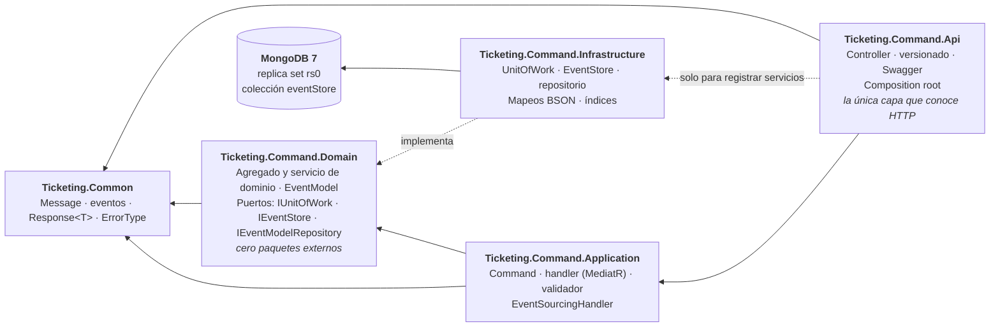

# Microservices-Events — Ticketing

Proyecto de microservicios **dirigidos por eventos** en **.NET 10** con **MongoDB**. Es un proyecto de
aprendizaje independiente del monolito: no forma parte de la migración Strangler Fig, tiene su propia
solución y su propio Docker.

El objetivo no es la cantidad de funcionalidad sino entender, con código que funciona, tres ideas que
suelen explicarse solo en teoría:

- **CQRS a nivel de servicio:** el lado de escritura (`Ticketing.Command`) y el de consulta
  (`Ticketing.Query`) son servicios distintos, cada uno con sus proyectos.
- **Event Sourcing:** el estado no se guarda como una fila que se modifica, sino como una secuencia de
  eventos inmutables en un *event store*. El estado de un ticket es el resultado de reproducir sus eventos.
- **Transacciones en MongoDB:** sesiones y transacciones sobre un replica set, aisladas tras un Unit of
  Work para que la capa de aplicación no conozca el driver.

## Piezas

| Pieza | Qué es |
|---|---|
| `Ticketing.Command` (Api, Application, Domain, Infrastructure) | Lado de escritura: `POST api/v1/TicketCreate/CreateTicket` crea un ticket y guarda su `TicketCreatedEvent` en el event store dentro de una transacción |
| `Ticketing.Common` | Contratos compartidos entre servicios: `Message`, `EventBase`, los eventos, `Response<T>` y `ErrorType` |
| `Ticketing.Query.Api` | API del servicio de consulta |
| Docker | MongoDB 7 como replica set de un nodo |
| CI | `ci-micro-events.yaml`: restaura, compila y ejecuta el proyecto de tests |

## Arquitectura

Clean Architecture con la misma regla que el monolito: **las dependencias apuntan siempre hacia dentro**,
hacia `Domain`.



`Ticketing.Command.Domain` no tiene un solo `PackageReference`: los puertos viven ahí, en quien los *usa*, e
`Infrastructure` los implementa con el driver de MongoDB. Los componentes uno a uno, con el recorrido de la
petición, están en [*Arquitectura*](docs/arquitectura.md#vista-de-componentes). También como imagen: el
[resumen por capas](docs/img/arquitectura-resumen.png).

## Estructura

```
Microservices-Events/
├── Docker/docker-compose.yml          MongoDB como replica set (rs0)
├── docs/                              Documentación (ver tabla siguiente)
└── Ticketing/
    ├── Ticketing.slnx
    ├── Ticketing.Core/
    │   └── Ticketing.Common/          Message, EventBase, eventos, Response<T>, ErrorType
    ├── Ticketing.Command/
    │   ├── Ticketing.Command.Api/             Controllers, versionado, Swagger, composition root
    │   ├── Ticketing.Command.Application/     Command, handler y validador (MediatR); EventSourcingHandler
    │   ├── Ticketing.Command.Domain/          Agregados y su servicio, EventModel, enums, excepciones, puertos
    │   ├── Ticketing.Command.Infrastructure/  MongoDB: contexto, sesión, UoW, repositorio, EventStore, mapeos, índices
    │   └── Ticketing.Command.UnitTest/
    └── Ticketing.Query/
        └── Ticketing.Query.Api/
```

## Documentación

| Documento | Qué cuenta |
|---|---|
| [Arquitectura](docs/arquitectura.md) | Proyectos y dependencias, arranque, registro en DI y recorrido completo de una petición |
| [Agregados y event sourcing](docs/agregados.md) | Cómo se modela un ticket como agregado inmutable, qué significan sus versiones y cómo se reproduce desde sus eventos |
| [Event store y modelo de eventos](docs/event-store.md) | Cómo se guarda un evento, el control de concurrencia, el mapeo a MongoDB y cómo añadir un evento nuevo |
| [Decisiones técnicas](docs/decisiones-tecnicas.md) | Las decisiones que tienen algo que explicar: replica set, UoW sobre Mongo, agregado inmutable, dónde vive cada pieza |
| [Entorno local](docs/entorno-local.md) | Cómo levantar MongoDB, ejecutar la API, probar el endpoint, tests y CI |

## Stack

.NET 10 · ASP.NET Core (controllers) · MongoDB 7 + `MongoDB.Driver` 3.12 · MediatR 14 · FluentValidation 12 ·
Asp.Versioning 10 · Swashbuckle 10 · xUnit.

## Puesta en marcha rápida

```bash
docker compose -f Microservices-Events/Docker/docker-compose.yml up -d
dotnet run --project Microservices-Events/Ticketing/Ticketing.Command/Ticketing.Command.Api
```

La API necesita MongoDB *healthy* antes de arrancar. Los detalles y el porqué de cada paso, en
[*Entorno local*](docs/entorno-local.md).
