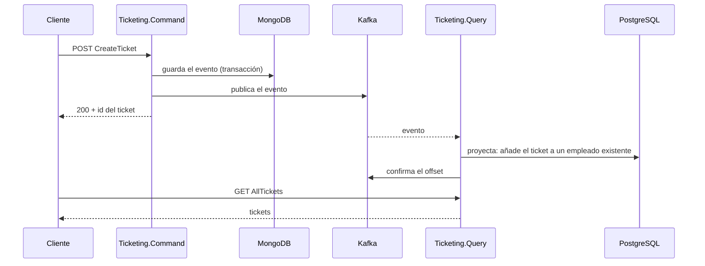

# Arquitectura general

[← Volver al README](../README.md)

`Ticketing` son **dos microservicios independientes**: `Ticketing.Command` (escritura, con event sourcing) y
`Ticketing.Query` (lectura). Cada uno usa Clean Architecture y tiene su base de datos y su *composition root*.

| Microservicio | Arquitectura | Decisiones | Más |
|---|---|---|---|
| `Ticketing.Command` | [Arquitectura](command/arquitectura.md) | [Decisiones](command/decisiones-tecnicas.md) | [Agregados](command/agregados.md) · [Event store](command/event-store.md) |
| `Ticketing.Query` | [Arquitectura](query/arquitectura.md) | [Decisiones](query/decisiones-tecnicas.md) | [Consumidor de Kafka](query/consumidor-kafka.md) |

## Comparativa

| | `Ticketing.Command` | `Ticketing.Query` |
|---|---|---|
| Rol | Recibe órdenes y las convierte en eventos | Sirve consultas sobre un modelo proyectado |
| Datos | Event sourcing en MongoDB 7 (`rs0`), base `ticketingApp` | Modelo relacional en PostgreSQL 16, base `eventspostgres` |
| Endpoint | `POST api/v1/TicketCreate/CreateTicket` | `GET api/v1/Ticket/AllTickets` |
| Puertos | `5166` / `7249` | `5270` / `7005` |
| Esquema | Índice único creado al arrancar | Migraciones de EF Core al arrancar |
| Con Kafka | Productor | Consumidor |
| Estado | `CreateTicket` completo, con validación, middleware y tests | Consumidor y proyección sin probar de extremo a extremo; migración por regenerar |

## Qué es independiente y qué se comparte

**Independiente:** proyectos y capas (ninguno referencia al otro), *composition root* y puertos, base de datos
(`Query` nunca lee la de `Command`) y arranque (uno puede estar en marcha sin el otro).

**Compartido:**

- **`Ticketing.Common`**: `EventBase`, `TicketCreatedEvent`, `TicketUpdatedEvent`, `eEventType`, `KafkaTopics`,
  `Message` (`Id`, `OcurredAt`, `OcurredBy`), `Response<T>`, `ErrorType` e `IEventProducer`. No conoce MongoDB
  ni ASP.NET.
- Un solo `Ticketing.slnx`, un `docker-compose.yml` y un workflow de CI (`ci-micro-events.yaml`), por
  comodidad.

**Acoplamientos que existen hoy**

- `Ticketing.Common` referencia `Confluent.Kafka` (por `IEventProducer`), y `Query` lo recibe también.
- Un cambio en un evento, en `eEventType` o en `KafkaTopics` obliga a recompilar los dos servicios. Es lo que
  ha pasado con `UserName` → `OcurredBy` en `TicketCreatedEvent`: `Command` lo aplicó y `Query` tiene que
  adaptarse.
- **Los valores de `eEventType` son contrato**: viajan como número en el JSON. Cambiarlos o reordenarlos rompe
  lo que ya está en Kafka.

## Cómo se comunican

`Command` publica los eventos en Kafka y `Query` los consume y los proyecta en PostgreSQL. El consumidor **no se
ha probado de extremo a extremo**; qué falta, en [*El consumidor de Kafka*](query/consumidor-kafka.md#qué-falta).

Entre que `Command` responde y `Query` proyecta hay un hueco: la consistencia es **eventual**. Garantías y
límites de la publicación (sin *outbox*) en [*Mensajería con Kafka*](mensajeria-kafka.md).

Los proyectos de cada servicio, con referencias y paquetes, en su arquitectura:
[Command](command/arquitectura.md#proyectos-y-dependencias) y
[Query](query/arquitectura.md#dependencias-entre-proyectos).
