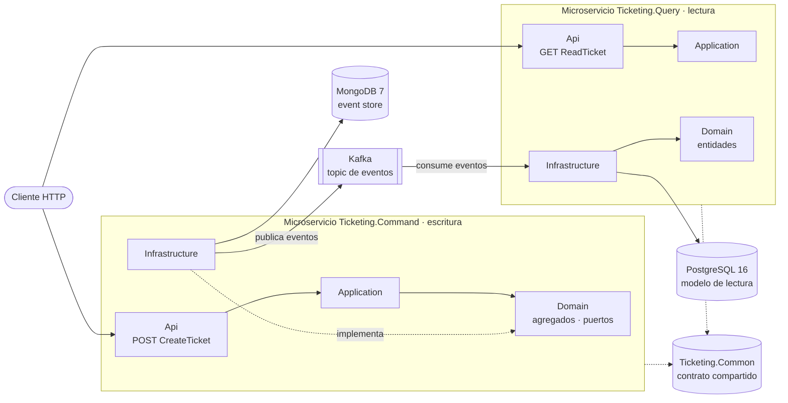
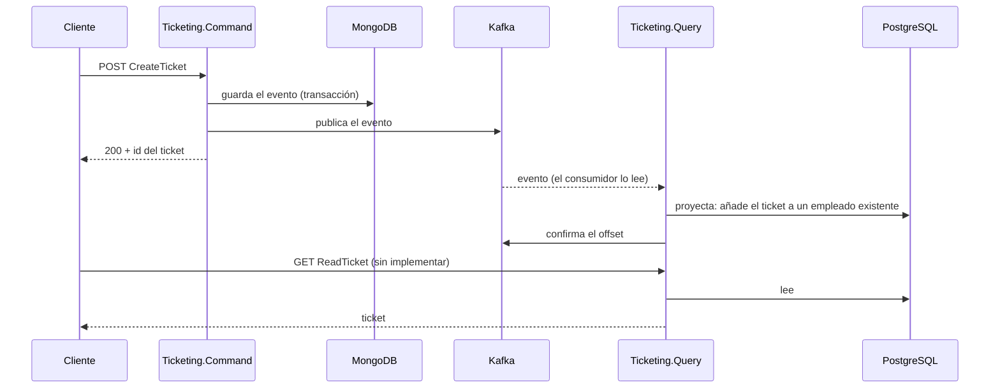

# Arquitectura general

[← Volver al README](../README.md)

`Ticketing` son **dos microservicios independientes**, `Ticketing.Command` (escritura) y `Ticketing.Query`
(lectura). Cada uno se construye con Clean Architecture y tiene su propia base de datos y su propio
*composition root*; el de escritura además usa event sourcing. Este documento explica cómo encajan. El
detalle de cada uno está en su carpeta:

| Microservicio | Arquitectura | Decisiones técnicas | Más |
|---|---|---|---|
| `Ticketing.Command` | [Arquitectura](command/arquitectura.md) | [Decisiones](command/decisiones-tecnicas.md) | [Agregados](command/agregados.md) · [Event store](command/event-store.md) |
| `Ticketing.Query` | [Arquitectura](query/arquitectura.md) | [Decisiones](query/decisiones-tecnicas.md) | [El consumidor de Kafka](query/consumidor-kafka.md) |

## Dos microservicios independientes



Los dos servicios no se llaman entre sí ni comparten base de datos: la única vía de comunicación prevista
es Kafka, y lo único que comparten en código es `Ticketing.Common`.

## Comparativa

| | `Ticketing.Command` | `Ticketing.Query` |
|---|---|---|
| Rol | Recibe órdenes y las convierte en eventos | Sirve consultas sobre un modelo ya proyectado |
| Patrón de datos | Event sourcing: secuencia de eventos inmutables | Modelo relacional con EF Core, rellenado por proyección de eventos |
| Almacén | MongoDB 7 (replica set `rs0`), base `ticketingApp` | PostgreSQL 16, base `eventspostgres` |
| Endpoint | `POST api/v1/TicketCreate/CreateTicket` | `GET api/v1/TicketCreate/ReadTicket` |
| Puertos | `5166` (HTTP), `7249` (HTTPS) | `5270` (HTTP), `7005` (HTTPS) |
| Capas | Api · Application · Domain · Infrastructure | Api · Application · Domain · Infrastructure |
| Esquema | Índice único creado al arrancar | Migraciones de EF Core aplicadas al arrancar |
| Con Kafka | Productor: publica cada evento guardado | Consumidor: proyecta cada evento en PostgreSQL |
| Estado | Caso de uso `CreateTicket` completo | Consumidor y proyección escritos, sin probar de extremo a extremo; `ReadTicket` sin implementar; migración por regenerar |

## Qué es independiente y qué se comparte

**Independiente**

- **Proyectos y capas:** cada servicio tiene sus cuatro proyectos y su proyecto de tests. Ninguno referencia
  proyectos del otro.
- **Composition root:** cada `Api` tiene su `Program.cs`, `appsettings`, `launchSettings` y puertos, así que
  se pueden arrancar, desplegar y escalar por separado.
- **Datos:** `Command` solo escribe en MongoDB y `Query` solo usa PostgreSQL. `Query` nunca lee la base de
  `Command`.
- **Arranque:** `Command` necesita MongoDB (y Kafka para crear tickets); `Query` solo necesita PostgreSQL.
  Uno puede estar en marcha sin el otro.

**Compartido**

- **`Ticketing.Common`** (`Ticketing.Core/`): el contrato que ambos deben entender igual: la jerarquía de
  eventos (`EventBase`, `TicketCreatedEvent`, `TicketUpdatedEvent`), el enum `eEventType`, el nombre del topic
  (`KafkaTopics`), `Message`, `Response<T>`, `ErrorType` e `IEventProducer`. No conoce MongoDB ni ASP.NET.
- **Un solo `Ticketing.slnx`**, un solo `docker-compose.yml` (los tres almacenes) y un solo workflow de CI
  (`ci-micro-events.yaml`), por comodidad del proyecto de aprendizaje.

**Acoplamientos que existen hoy**

- `Ticketing.Common` referencia `Confluent.Kafka` (por `IEventProducer`), así que `Query` lo recibe también de
  forma transitiva; además lo referencia directamente en `Infrastructure`, que es donde está el consumidor.
- Un cambio en un evento, en `eEventType` o en `KafkaTopics` obliga a recompilar los dos servicios.
- **Los valores de `eEventType` son parte del contrato**: viajan como número en el JSON y el consumidor los
  usa para saber qué clase de evento deserializar. Cambiarlos o reordenarlos rompe lo que ya está en Kafka.

## Cómo se comunican

Los eventos viajan por Kafka: `Command` los publica y `Query` los consume y los proyecta en PostgreSQL. El
consumidor está escrito pero **no se ha probado de extremo a extremo**; qué falta, en
[*El consumidor de Kafka*](query/consumidor-kafka.md#qué-falta).



Entre que `Command` responde y `Query` proyecta hay un hueco: la consistencia entre los dos servicios es
**eventual**.

Cada evento se guarda y se publica con ciertas garantías y limitaciones (publicación antes del `Commit`, sin
*outbox*): ver [*Mensajería con Kafka*](mensajeria-kafka.md).

## Solución y proyectos

```
Microservices-Events/
├── Docker/docker-compose.yml          MongoDB, Zookeeper, Kafka, Kafka UI y PostgreSQL
├── docs/
└── Ticketing/
    ├── Ticketing.slnx
    ├── Ticketing.Core/
    │   └── Ticketing.Common/          Contrato compartido
    ├── Ticketing.Command/             Microservicio de escritura
    │   ├── Ticketing.Command.Api/
    │   ├── Ticketing.Command.Application/
    │   ├── Ticketing.Command.Domain/
    │   ├── Ticketing.Command.Infrastructure/
    │   └── Ticketing.Command.UnitTest/
    └── Ticketing.Query/               Microservicio de lectura
        ├── Ticketing.Query.Api/
        ├── Ticketing.Query.Application/
        ├── Ticketing.Query.Domain/
        ├── Ticketing.Query.Infrastructure/
        └── Ticketing.Query.UnitTest/
```

| Proyecto compartido | Responsabilidad | Referencias | Paquetes |
|---|---|---|---|
| `Ticketing.Common` | Eventos, `eEventType`, `KafkaTopics`, `Message`, `Response<T>`, `ErrorType` e `IEventProducer` | — | `Confluent.Kafka` 2.16.0, `Microsoft.Extensions.Logging.Abstractions` |

Los proyectos de cada servicio, con sus referencias y paquetes, están en la arquitectura de cada uno:
[Command](command/arquitectura.md#proyectos-y-dependencias) y
[Query](query/arquitectura.md#dependencias-entre-proyectos).
