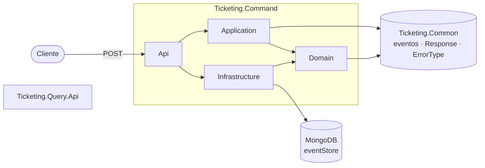
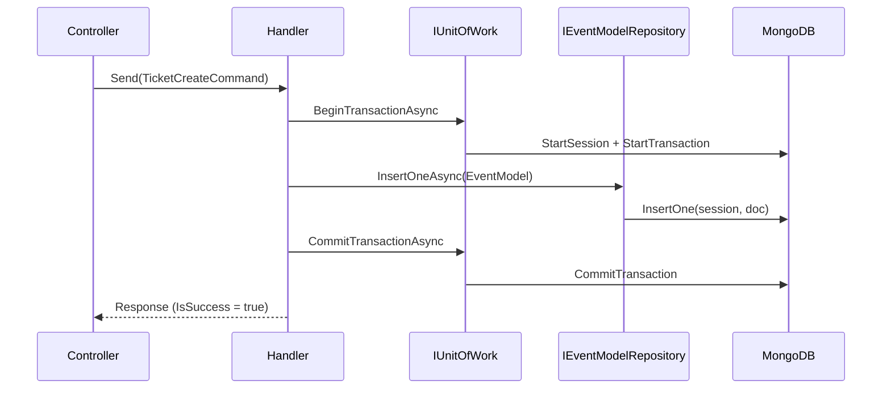

# Arquitectura

[← Volver al README](../README.md)

Cómo está organizado `Ticketing` y por dónde pasa una petición. Los matices de *por qué* está así están en
[*Decisiones técnicas*](decisiones-tecnicas.md).

## Dos servicios, un contrato común

- **`Ticketing.Command`** recibe órdenes y las convierte en eventos. Es el único lado con lógica.
- **`Ticketing.Query`** es el lado de lectura.
- **`Ticketing.Common`** (`Ticketing.Core/`) es lo que ambos servicios deben entender igual: la jerarquía
  de eventos y el contrato de respuesta. No conoce MongoDB ni ASP.NET.

## Capas de `Ticketing.Command`

La dependencia apunta siempre hacia dentro (hacia `Domain`):

| Proyecto | Responsabilidad | Depende de |
|---|---|---|
| `Api` | HTTP: controllers, versionado por URL, Swagger. Traduce `ErrorType` a código HTTP. | `Application`, `Infrastructure` |
| `Application` | Casos de uso: *command* + *handler* (MediatR), validador (FluentValidation), mapeo (AutoMapper). | `Domain`, `Common` |
| `Domain` | `EventModel`, enums (`eEventType`, `eAggregateType`) y los **puertos**: `IEventModelRepository`, `IUnitOfWork`. | `Common` |
| `Infrastructure` | Los **adaptadores**: implementa los puertos con MongoDB (contexto, sesión, UoW, repositorios, mapeos BSON). | `Domain` |

`Application` solo ve interfaces de `Domain`; nunca `MongoDB.Driver`. Eso es lo que permite que el handler
sea el mismo si mañana el event store deja de ser MongoDB.

`Api` referencia `Infrastructure` únicamente para llamar a `AddInfrastructureServices` en el *composition
root* (`Program.cs`); el resto del código de `Api` no la usa.

## Recorrido de una petición

`POST /api/v1/TicketCreate/CreateTicket`

1. **`TicketCreate`** (controller) recibe el `TicketCreateCommand` del body y lo envía con `IMediator`.
   No sabe quién lo atiende.
2. **`TicketCreateCommandHandler`** construye un `EventModel` con:
   - `AggregateIdentifier`: un GUID v7 nuevo (ordenable por tiempo).
   - `AggregateType = TicketAggregate`, `EventType = TicketCreatedEvent`, `Version = 1`.
   - `EventData`: el `TicketCreatedEvent`, obtenido del command con AutoMapper.
3. Abre una transacción con **`IUnitOfWork.BeginTransactionAsync`**. `Infrastructure` inicia una sesión de
   Mongo, arranca la transacción y deja la sesión en `IMongoSessionContext.Current`.
4. **`IEventModelRepository.InsertOneAsync`** inserta el documento. El repositorio lee la sesión actual del
   contexto: si hay una, inserta dentro de la transacción; si no, inserta sin ella.
5. **`CommitTransactionAsync`** confirma y el handler cierra la sesión (`Dispose`). Si algo falla, hace
   `RollbackAsync`, cierra la sesión y **relanza** la excepción.
6. El handler devuelve `Response<string>.Success(ticket.Id)`, con el id del ticket creado en `Data`, y el controller lo traduce con
   `ToActionResult` (200 si va bien; si no, según `ErrorType`).

## Cómo se comparten la sesión y los repositorios

Tres piezas, todas `Scoped` (una instancia por petición HTTP), que colaboran sin conocerse:

| Pieza | Papel |
|---|---|
| `IMongoSession` / `MongoSession` | Envuelve las operaciones del driver sobre `IMongoClient`: iniciar sesión, empezar, confirmar, abortar, liberar. |
| `IMongoSessionContext` / `MongoSessionContext` | Caja con la sesión activa (`Current`). Es el canal por el que el UoW "avisa" a los repositorios. |
| `UnitOfWork` | Orquesta: abre la sesión, la publica en el contexto y la retira al terminar. |

Los repositorios no reciben la sesión por parámetro: la leen del contexto. Así el handler no tiene que
pasar nada de Mongo a los repositorios, y el mismo repositorio sirve dentro y fuera de una transacción.

## Contrato de respuesta

`Response<T>` (en `Common`) devuelve el resultado como valor: `Success`, `Fail`, `NotFound` e `Invalid`.
`ErrorType` dice *qué* falló y `ApiResponseControllerBase.ToActionResult` decide *cómo* se comunica:

| `ErrorType` | HTTP |
|---|---|
| `Validation`, `InvalidOperation` | 400 |
| `Unauthorized` | 401 |
| `NotFound` | 404 |
| `Duplicated` | 409 |
| `TimeOut` | 504 |
| `Unexpected`, `None`, no contemplado | 500 |

Es el mismo planteamiento que el del monolito (ver su
[*Decisiones técnicas*](../../Monolito/docs/decisiones-tecnicas.md)): `Application` no sabe qué es un 404.

## Versionado

Por segmento de URL (`api/v1/...`) con `Asp.Versioning`; `DefaultApiVersion` 1.0 y
`AssumeDefaultVersionWhenUnspecified`. Swagger genera un documento por versión y solo se expone en
`Development`.
