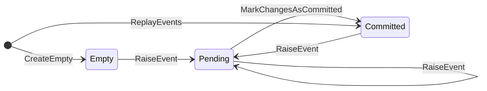

# Agregados y event sourcing

[← Volver al README](../../README.md)

Cómo se modela un ticket en el lado de escritura y cómo pasa de eventos a estado y de estado a eventos. El
guardado en Mongo está en [*Event store*](event-store.md).

## Idea

Un **agregado** es la unidad de consistencia: lo que le pasa a un ticket se decide sobre el ticket entero. En
event sourcing no se persiste como documento sino como los eventos que lo cambiaron, y se reconstruye
reproduciéndolos en orden. Aquí el agregado es un **valor inmutable** y las reglas viven en un **servicio de
dominio**: ninguna operación lo modifica, cada una devuelve uno nuevo.

| Pieza | Dónde | Qué hace |
|---|---|---|
| `AggregateRoot` | `Domain/Aggregates` | Base abstracta: `Id`, `Version`, `VersionBeforeChanges` y `UncommittedChanges`, de solo lectura |
| `TicketAggregate` | `Domain/Aggregates/Tickets` | El ticket; añade `Active`. Sin comportamiento |
| `AggregateService<T>` | `Domain/Aggregates` | Escribe una vez las operaciones comunes (`ReplayEvents`, `MarkChangesAsCommitted`, `RaiseEvent` protegido); deja tres huecos a cada agregado |
| `TicketAggregateService` | `Domain/Services` | Rellena los huecos para el ticket y define `Create` |
| `EventSourcingHandler<T>` | `Application/EventSourcing` | Carga un agregado por id y guarda sus cambios pendientes |

## Las cuatro propiedades

| Propiedad | Qué es |
|---|---|
| `Id` | Vacío en un agregado recién creado (`CreateEmpty`); lo fija el primer evento |
| `Version` | Eventos aplicados, guardados o no |
| `VersionBeforeChanges` | Versión que tenía en el event store antes de los cambios pendientes; la que espera el control de concurrencia |
| `UncommittedChanges` | Eventos lanzados en esta operación y aún sin guardar |

Siempre: `Version = VersionBeforeChanges + UncommittedChanges.Count`.



`Pending` es lo único que `SaveAsync` tiene que persistir; un agregado cargado con `ReplayEvents` nace en `Committed`.

## Las tres transiciones

Se apoyan en dos huecos por agregado, `ApplyEvent` (cómo cambia el estado con un evento) y `CopyWith` (copia con
otra versión y otros cambios), más `CreateEmpty` para el punto de partida.

| Transición | Cuándo | `Version` | `VersionBeforeChanges` | `UncommittedChanges` |
|---|---|---|---|---|
| `RaiseEvent` (protegido) | Una orden produce un evento | +1 | se conserva | se añade el evento |
| `ReplayEvents` | Se reconstruye desde eventos guardados | +1 por evento | = `Version` | vacía |
| `MarkChangesAsCommitted` | Tras confirmar la transacción | se conserva | = `Version` | vacía |

En el ticket, `ApplyEvent` es un `switch` por tipo: `TicketCreatedEvent` toma el `Id` del evento y pone
`Active = true`. Un evento desconocido lanza `InvalidOperationException`, para que un evento nuevo sin su `case`
falle en vez de ignorarse.

## Crear un ticket, paso a paso

`TicketAggregateService.Create(userName, errorType, errorDetail)`:

1. Genera el id con `Guid.CreateVersion7()`.
2. Construye el `TicketCreatedEvent` con ese id, `OcurredAt = DateTime.UtcNow`, `OcurredBy = userName` y
   `ErrorDetail = errorDetail` (`errorType` llega pero no se usa: el evento no lo lleva).
3. Parte de `CreateEmpty()` y lanza el evento con `RaiseEvent`.

| Momento | `Id` | `Active` | `Version` | `VersionBeforeChanges` | `UncommittedChanges` |
|---|---|---|---|---|---|
| `CreateEmpty` | `""` | `false` | 0 | 0 | `[]` |
| `RaiseEvent(TicketCreatedEvent)` | id nuevo | `true` | 1 | 0 | `[TicketCreatedEvent]` |
| `MarkChangesAsCommitted` (tras `SaveAsync` con `expectedVersion = 0`) | id nuevo | `true` | 1 | 1 | `[]` |

El id **lo decide el dominio**, no la base de datos: viaja en el evento, y el `_id` del documento en Mongo es otra
cosa.

## Cargar y guardar

**`GetByIdAsync(aggregateId)`:** `IEventStore.GetEventsAsync` devuelve los eventos ordenados por versión (si no hay
ninguno, `AggregateNotFoundException`) y `ReplayEvents` los aplica sobre un agregado vacío. Queda con
`Version = VersionBeforeChanges` y sin cambios pendientes.

**`SaveAsync(aggregate)`:** toma `UncommittedChanges` y `VersionBeforeChanges` (la versión esperada), obtiene
`eAggregateType` con `Enum.Parse` del nombre de la clase (**convención:** cada agregado necesita un valor del enum
con su mismo nombre) y llama a `IEventStore.SaveEventsAsync`. No abre ni confirma la transacción, ni marca los
cambios como confirmados: eso lo hace el caso de uso después del *commit* (si fuera antes y el *commit* fallase,
el agregado diría que está guardado sin estarlo).

## Registro en DI

`EventSourcingHandler<T>` pide un `IAggregateService<T>`; para el ticket se registra con una factoría que devuelve
la misma instancia de `ITicketAggregateService`. Un agregado nuevo necesita sus dos registros equivalentes:

```csharp
services.AddScoped<ITicketAggregateService, TicketAggregateService>();
services.AddScoped<IAggregateService<TicketAggregate>>(sp => sp.GetRequiredService<ITicketAggregateService>());
```
