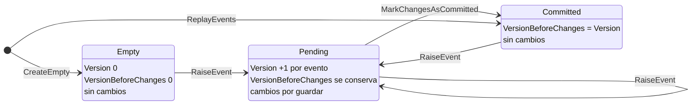

# Agregados y event sourcing

[← Volver al README](../../README.md)

Cómo se modela un ticket en el lado de escritura y cómo pasa de eventos a estado y de estado a eventos.
Cómo se guardan esos eventos en Mongo está en [*Event store*](event-store.md).

## Idea

Un **agregado** es la unidad de consistencia: todo lo que le pasa a un ticket se decide sobre el ticket
entero y se guarda junto. En event sourcing el agregado no se persiste como documento: se persisten los
eventos que lo cambiaron, y el agregado se reconstruye reproduciéndolos en orden.

En este proyecto el agregado es un **valor inmutable** y las reglas que lo cambian viven en un **servicio de
dominio**. Ninguna operación modifica un agregado: cada una devuelve uno nuevo.

| Pieza | Dónde | Qué hace |
|---|---|---|
| `AggregateRoot` | `Domain/Aggregates` | Clase base abstracta: `Id`, `Version`, `VersionBeforeChanges` y `UncommittedChanges`, todo de solo lectura y fijado en el constructor. |
| `TicketAggregate` | `Domain/Aggregates/Tickets` | El ticket. Añade `Active`. Sin comportamiento. |
| `IAggregateService<T>` | `Domain/Aggregates` | Operaciones genéricas que necesita quien carga o guarda un agregado: `ReplayEvents` y `MarkChangesAsCommitted`. |
| `AggregateService<T>` | `Domain/Aggregates` | Implementa esas operaciones una sola vez para cualquier agregado, y el `RaiseEvent` protegido que usan las órdenes. Deja tres huecos abstractos a cada agregado. |
| `ITicketAggregateService` | `Domain/Interfaces` | Lo anterior más las órdenes del ticket: hoy, `Create`. |
| `TicketAggregateService` | `Domain/Services` | Rellena los huecos para el ticket y define `Create`. |
| `EventSourcingHandler<T>` | `Application/EventSourcing` | Une agregado y event store: carga un agregado por id y guarda sus cambios pendientes. |

## Las cuatro propiedades de un agregado

| Propiedad | Qué es |
|---|---|
| `Id` | Identificador del agregado. Vacío en un agregado recién creado por `CreateEmpty`; lo fija el primer evento. |
| `Version` | Cuántos eventos se le han aplicado, guardados o no. |
| `VersionBeforeChanges` | Versión que tenía en el event store antes de los cambios pendientes. Es la que el control de concurrencia espera encontrar al guardar. |
| `UncommittedChanges` | Eventos lanzados en esta operación y aún no guardados. |

Siempre se cumple `Version = VersionBeforeChanges + UncommittedChanges.Count`.

### Ciclo de vida



`Pending` es el único estado que `EventSourcingHandler.SaveAsync` tiene que persistir; al confirmarse la
transacción pasa a `Committed`. Un agregado cargado con `ReplayEvents` nace ya en `Committed`.

## Las tres transiciones

`AggregateService<T>` define cómo cambian esas propiedades. Las tres se apoyan en dos huecos que rellena
cada agregado: `ApplyEvent` (cómo cambia el estado de negocio con un evento) y `CopyWith` (copia del
agregado con otra versión, otra versión previa y otros cambios, sin tocar el resto).

| Transición | Cuándo | `Version` | `VersionBeforeChanges` | `UncommittedChanges` |
|---|---|---|---|---|
| `RaiseEvent` (protegido) | Una orden produce un evento nuevo | +1 | se conserva | se añade el evento |
| `ReplayEvents` | Se reconstruye desde eventos ya guardados | +1 por evento | = `Version` | vacía |
| `MarkChangesAsCommitted` | Tras confirmar la transacción | se conserva | = `Version` | vacía |

`ReplayEvents` tiene dos sobrecargas: una parte de un agregado dado y la otra de uno vacío, que crea el
propio servicio con `CreateEmpty` (el tercer hueco). La segunda es la que usa
`EventSourcingHandler.GetByIdAsync`.

En el ticket, `ApplyEvent` es un `switch` por tipo de evento: `TicketCreatedEvent` toma el `Id` del evento y
pone `Active = true`. Un evento que el servicio no conoce lanza `InvalidOperationException`; así un evento
nuevo sin su `case` falla en lugar de ignorarse en silencio.

## Crear un ticket, paso a paso

`TicketAggregateService.Create(userName, errorType, errorDetail)`:

1. Genera el id con `Guid.CreateVersion7()`.
2. Construye el `TicketCreatedEvent` con ese id y `UserName` y `DetailError` del command. `errorType` llega por
   parámetro pero ya no se usa: el evento no lo lleva.
3. Parte de `CreateEmpty()`: id vacío, versión 0, sin cambios, inactivo.
4. Lo lanza con `RaiseEvent`.

| Momento | `Id` | `Active` | `Version` | `VersionBeforeChanges` | `UncommittedChanges` |
|---|---|---|---|---|---|
| `CreateEmpty` | `""` | `false` | 0 | 0 | `[]` |
| `RaiseEvent(TicketCreatedEvent)` | id nuevo | `true` | 1 | 0 | `[TicketCreatedEvent]` |
| `SaveAsync` guarda con `expectedVersion = 0` | | | | | |
| `MarkChangesAsCommitted` | id nuevo | `true` | 1 | 1 | `[]` |

El handler devuelve ese `Id` al cliente. El id **lo decide el dominio**, no la base de datos: viaja dentro
del evento, y el `_id` del documento en Mongo es otra cosa (ver [*Event store*](event-store.md)).

## Cargar un agregado

`EventSourcingHandler<T>.GetByIdAsync(aggregateId)`:

1. `IEventStore.GetEventsAsync` devuelve los eventos del agregado ordenados por versión. Si no hay
   ninguno, lanza `AggregateNotFoundException`.
2. `IAggregateService<T>.ReplayEvents(events)` los aplica sobre un agregado vacío.

El resultado queda con `Version = VersionBeforeChanges = número de eventos` y sin cambios pendientes:
listo para que una orden lance eventos nuevos y se guarde con la versión correcta.

## Guardar un agregado

`EventSourcingHandler<T>.SaveAsync(aggregate)`:

1. Toma `UncommittedChanges` y `VersionBeforeChanges` (la versión esperada).
2. Obtiene `eAggregateType` con `Enum.Parse` del nombre de la clase (`TicketAggregate`). **Convención:** cada
   agregado necesita un valor del enum con su mismo nombre, o falla en tiempo de ejecución.
3. Llama a `IEventStore.SaveEventsAsync`. No abre ni confirma la transacción: eso lo decide el caso de uso.

Marcar los cambios como confirmados también es responsabilidad del caso de uso, después del *commit*: si se
hiciera antes y el *commit* fallase, el agregado en memoria diría que sus eventos están guardados sin
estarlo.

## Registro en DI

`EventSourcingHandler<T>` pide un `IAggregateService<T>`. Para el ticket se registra con una factoría que
devuelve la misma instancia de `ITicketAggregateService`:

```csharp
services.AddScoped<ITicketAggregateService, TicketAggregateService>();
services.AddScoped<IAggregateService<TicketAggregate>>(sp => sp.GetRequiredService<ITicketAggregateService>());
```

Un agregado nuevo necesita sus dos registros equivalentes.
