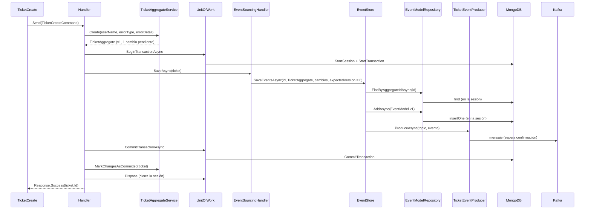

# Arquitectura de Ticketing.Command

[← Volver al README](../../README.md) · [Arquitectura general](../arquitectura.md)

Cómo está organizado el microservicio de escritura y por dónde pasa una petición. Es un servicio
independiente: tiene sus propias capas, su propia base de datos (MongoDB) y su propio `Program.cs`. Cómo
encaja con `Ticketing.Query` está en la [arquitectura general](../arquitectura.md). Los matices de *por qué*
está así están en [*Decisiones técnicas*](decisiones-tecnicas.md); el modelo de agregado, en
[*Agregados y event sourcing*](agregados.md).

## Vista de componentes

Cada recuadro es una clase o interfaz real. Las flechas son llamadas en tiempo de ejecución; las líneas
punteadas unen un puerto con la clase que lo implementa. Los puertos (`I...`) viven en `Domain`:
`Application` solo habla con ellos y `Infrastructure` los implementa. La excepción es `IEventProducer`, que
vive en `Ticketing.Common` y se dibuja aparte. `Ticketing.Common` (eventos y `Response<T>`) lo usan `Api`,
`Application` y `Domain` y no se dibuja para no cruzar todas las flechas.

```mermaid
flowchart LR
    Client([Cliente HTTP])

    subgraph API["Api"]
        direction TB
        Ctrl["TicketCreate<br/>POST api/v1/TicketCreate/CreateTicket"]
    end

    subgraph APP["Application"]
        direction TB
        Handler["TicketCreateCommandHandler<br/>fija la transacción"]
        ESH["EventSourcingHandler"]
    end

    subgraph DOM["Domain"]
        direction TB
        TAS["TicketAggregateService<br/>crea el TicketAggregate"]
        subgraph PORTS["Puertos"]
            direction TB
            IUoW["IUnitOfWork"]
            IES["IEventStore"]
            IEMR["IEventModelRepository"]
        end
    end

    subgraph INF["Infrastructure"]
        direction TB
        UoW["UnitOfWork"]
        Ctx["MongoSessionContext"]
        ES["EventStore<br/>versión y concurrencia"]
        Repo["EventModelRepository"]
        DbCtx["MongoDbContext"]
        Prod["TicketEventProducer"]
    end

    subgraph COMMON["Common"]
        IEP["IEventProducer"]
    end

    subgraph DB["MongoDB 7 · replica set rs0"]
        direction TB
        Coll[("ticketingApp.eventStore")]
        Idx["índice único<br/>AggregateIdentifier + Version"]
    end

    subgraph BROKER["Kafka · 1 broker"]
        direction TB
        Topic[["topic KafkaTopics.TicketEvents"]]
    end

    Client -->|JSON| Ctrl
    Ctrl -->|MediatR Send| Handler
    Handler -->|Create| TAS
    Handler -->|Begin / Commit / Rollback| IUoW
    Handler -->|SaveAsync| ESH
    ESH -->|SaveEventsAsync| IES

    IUoW -.-|implementado por| UoW
    IES -.-|implementado por| ES
    IEMR -.-|implementado por| Repo

    UoW -->|publica sesión| Ctx
    Repo -->|lee sesión| Ctx
    ES -->|usa| Repo
    ES -->|ProduceAsync| IEP
    IEP -.-|implementado por| Prod
    Repo --> DbCtx

    UoW -->|sesión + transacción| Coll
    DbCtx -->|insertOne / find| Coll
    Coll --- Idx
    Prod -->|JSON| Topic

    classDef api fill:#dbeafe,stroke:#2563eb,color:#0f172a
    classDef app fill:#dcfce7,stroke:#16a34a,color:#0f172a
    classDef dom fill:#fef9c3,stroke:#ca8a04,color:#0f172a
    classDef inf fill:#ffedd5,stroke:#ea580c,color:#0f172a
    classDef db fill:#e2e8f0,stroke:#475569,color:#0f172a
    class Ctrl api
    class Handler,ESH app
    class TAS,IUoW,IES,IEMR dom
    class UoW,Ctx,ES,Repo,DbCtx,Prod inf
    class IEP dom
    class Coll,Idx,Topic db
```

**Cómo leerlo**

- **Regla de dependencia:** `Api` → `Application` → `Domain` ← `Infrastructure`. Nada en `Domain` conoce
  MongoDB; todo el driver queda dentro de `Infrastructure`.
- **Una sola transacción por petición:** `UnitOfWork` abre la sesión y la deja en `MongoSessionContext`
  (`Scoped`); `EventModelRepository` la lee de ahí. Por eso `Application` no pasa ninguna sesión al guardar.
- **Dos niveles de concurrencia:** `EventStore` compara la versión esperada con la última guardada y el índice
  único de `eventStore` rechaza dos eventos con el mismo (agregado, versión).
- **Publicación en Kafka:** `EventStore` envía cada evento al topic justo después de insertarlo en Mongo y
  antes del `Commit`. Las dos escrituras no comparten transacción: ver
  [*Cuándo se publica*](../mensajeria-kafka.md#cuándo-se-publica).
- **`Ticketing.Common`** es el contrato compartido: eventos, `Response<T>` e `IEventProducer`, sin
  dependencias de MongoDB ni de ASP.NET (sí del paquete `Confluent.Kafka`).

## Proyectos y dependencias

La dependencia apunta siempre hacia dentro (hacia `Domain`):

| Proyecto | Responsabilidad | Referencias de proyecto | Paquetes |
|---|---|---|---|
| `Ticketing.Command.Api` | HTTP: controller, versionado por URL, Swagger. Traduce `ErrorType` a código HTTP. *Composition root*. | `Application`, `Infrastructure` | `Asp.Versioning.Mvc` y `.ApiExplorer` 10.2.1, `Swashbuckle.AspNetCore` y `.Annotations` 10.3.1, `Microsoft.AspNetCore.OpenApi` 10.0.11 |
| `Ticketing.Command.Application` | Caso de uso: *command* + *handler* (MediatR) y validador (FluentValidation). `EventSourcingHandler<T>`, que une agregado y event store. | `Domain`, `Common` | `MediatR` 14.2.0, `FluentValidation` y `.DependencyInjectionExtensions` 12.2.0, `Microsoft.Extensions.DependencyInjection.Abstractions` |
| `Ticketing.Command.Domain` | Agregados (`AggregateRoot`, `TicketAggregate`) y sus servicios (`AggregateService<T>`, `TicketAggregateService`), `EventModel`, enums, excepciones y los **puertos**. | `Common` | — |
| `Ticketing.Command.Infrastructure` | Los **adaptadores**: los de MongoDB (contexto, sesión, Unit of Work, repositorio, `EventStore`, mapeos BSON e índices) y el productor de Kafka (`TicketEventProducer`). | `Domain` | `MongoDB.Driver` y `MongoDB.Bson` 3.12.0, `Microsoft.Extensions.Configuration.Abstractions`, `Microsoft.Extensions.Options`; `Confluent.Kafka` llega transitivo desde `Common` |
| `Ticketing.Command.UnitTest` | Proyecto de tests. | — | xUnit 2.9.3, coverlet |

`Ticketing.Common` (contratos compartidos con `Ticketing.Query`) se describe en la [arquitectura general](../arquitectura.md#qué-es-independiente-y-qué-se-comparte).

`Application` solo ve interfaces de `Domain`; nunca `MongoDB.Driver`. Eso es lo que permite que el handler
sea el mismo si mañana el event store deja de ser MongoDB.

`Api` referencia `Infrastructure` para llamar a `AddInfrastructureServices` y `EnsureMongoIndexesAsync` en
el *composition root* (`Program.cs`); el resto de `Api` no la usa.

### Puertos y adaptadores

| Puerto (en `Domain`) | Implementación | Dónde |
|---|---|---|
| `IUnitOfWork` | `UnitOfWork` | `Infrastructure/Repository/UnitOfWork` |
| `IEventModelRepository` | `EventModelRepository` | `Infrastructure/Repository/EventModelRepository` |
| `IEventStore` | `EventStore` | `Infrastructure/Persistence` |
| `IEventProducer` (en `Common`, no en `Domain`) | `TicketEventProducer` | `Infrastructure/Persistence` |
| `IEventSourcingHandler<T>` | `EventSourcingHandler<T>` | `Application/EventSourcing` |
| `IAggregateService<T>`, `ITicketAggregateService` | `TicketAggregateService` (hereda de `AggregateService<T>`) | `Domain/Services` |

`IMongoSessionContext` e `IMongoBaseRepository<T>` son interfaces internas de `Infrastructure`, no puertos
del dominio.

## Arranque (`Program.cs`)

1. **Registro de servicios**, en este orden: `AddControllers`, `AddApplicationServices`,
   `AddInfrastructureServices(configuration)`, `AddVersioning`, `AddSwaggerGen`, `AddOpenApi`.
2. **`AddInfrastructureServices` valida la configuración**: si falta `ConnectionStrings:MongoDbConnection`,
   `MongoSettings:Database`, `KafkaSettings:HostName` o `KafkaSettings:Port`, lanza
   `InvalidOperationException` y la aplicación no arranca. (El nombre del topic no es configuración: es la
   constante `KafkaTopics.TicketEvents`.) También registra los mapeos BSON (`MongoClassMaps.Register()`), que deben existir antes de la primera
   serialización.
3. **`Build()`** y, antes de aceptar peticiones, **`EnsureMongoIndexesAsync`**: crea (si no existe) el
   índice único `ux_aggregate_version` sobre `eventStore`. Es idempotente, va fuera de cualquier
   transacción y, como efecto, crea la colección. Si MongoDB no responde, el arranque se queda esperando la
   selección de servidor y termina fallando: la API **no arranca sin Mongo**. Con Kafka no ocurre lo mismo:
   el `ProducerConfig` no abre ninguna conexión, así que la API arranca aunque el broker esté caído.
4. **Swagger y Swagger UI**, solo en `Development`, con un endpoint por cada versión que describe
   `IApiVersionDescriptionProvider`.
5. **Pipeline**: `UseHttpsRedirection`, `UseAuthorization`, `MapControllers`.

## Registro en DI

| Servicio | Implementación | Vida | Lo registra |
|---|---|---|---|
| Handlers de MediatR | Escaneo del ensamblado de `Application` | Transient (por defecto de MediatR) | `AddApplicationServices` |
| `IValidator<TicketCreateCommand>` | `TicketCreateValidator` | Scoped (por defecto de FluentValidation) | `AddApplicationServices` |
| `IEventSourcingHandler<>` | `EventSourcingHandler<>` (genérico abierto) | Scoped | `AddApplicationServices` |
| `ITicketAggregateService` | `TicketAggregateService` | Scoped | `AddApplicationServices` |
| `IAggregateService<TicketAggregate>` | La misma instancia de `ITicketAggregateService` (factoría) | Scoped | `AddApplicationServices` |
| `IMongoClient` | `MongoClient(connectionString)` | Singleton | `AddInfrastructureServices` |
| `MongoDbContext` | `MongoDbContext(client, databaseName)` | Singleton | `AddInfrastructureServices` |
| `ClientSessionOptions` | Con `TransactionOptions` vacías (heredan del cliente) | Singleton | `AddInfrastructureServices` |
| `ProducerConfig` | `BootstrapServers = "{HostName}:{Port}"` | Singleton | `AddInfrastructureServices` |
| `IEventProducer` | `TicketEventProducer` | Singleton | `AddInfrastructureServices` |
| `IUnitOfWork` | `UnitOfWork` | Scoped | `AddInfrastructureServices` |
| `IMongoSessionContext` | `MongoSessionContext` | Scoped | `AddInfrastructureServices` |
| `IEventModelRepository` | `EventModelRepository` | Scoped | `AddInfrastructureServices` |
| `IEventStore` | `EventStore` | Scoped | `AddInfrastructureServices` |
| `IMongoBaseRepository<>` | `MongoRepository<>` | Scoped | `AddInfrastructureServices` |

`TicketAggregateService` vive en `Domain`, pero lo registra `Application`, porque `Domain` no referencia
paquetes de inyección de dependencias.

`IMongoClient` es singleton porque así lo recomienda el driver: gestiona su propio *pool* de conexiones y
es seguro entre hilos. Todo lo que guarda estado de una petición (la sesión activa) es `Scoped`.

## Recorrido de una petición

`POST /api/v1/TicketCreate/CreateTicket`

1. **`TicketCreate`** (controller) recibe el `TicketCreateCommand` del body y lo envía con `IMediator`,
   pasando el `CancellationToken` de la petición. No sabe quién lo atiende.
2. **`TicketCreateCommandHandler`** pide a **`ITicketAggregateService.Create`** un ticket nuevo. El servicio
   genera el id (GUID v7), construye el `TicketCreatedEvent` y lo lanza sobre un ticket vacío: devuelve un
   `TicketAggregate` en versión 1, activo, con ese evento como cambio pendiente. Detalle en
   [*Agregados*](agregados.md#crear-un-ticket-paso-a-paso).
3. Abre la transacción con **`IUnitOfWork.BeginTransactionAsync`**: `Infrastructure` inicia una sesión de
   Mongo, arranca la transacción y deja la sesión en `IMongoSessionContext.Current`.
4. **`IEventSourcingHandler<TicketAggregate>.SaveAsync`** toma los cambios pendientes del agregado y su
   versión previa (`VersionBeforeChanges`, aquí 0), deduce `eAggregateType` del nombre de la clase y llama a
   **`IEventStore.SaveEventsAsync`**.
5. **`EventStore`** lee dentro de la transacción los eventos ya guardados del agregado, comprueba que la
   última versión coincide con la esperada (si no, `ConcurrencyException`) y envuelve cada evento en un
   `EventModel` numerado. **`EventModelRepository.AddAsync`** lo inserta con la sesión del contexto;
   si el índice único rechaza la versión, también traduce el error a `ConcurrencyException`. Detalle en
   [*Event store*](event-store.md#guardar-eventos).
   Justo después de insertar cada evento, **`IEventProducer.ProduceAsync`** lo envía al topic de Kafka y
   espera la confirmación del broker (ver [*Mensajería con Kafka*](../mensajeria-kafka.md)).
6. **`CommitTransactionAsync`** confirma. El handler marca los cambios como confirmados
   (`MarkChangesAsCommitted`) y cierra la sesión (`Dispose`).
7. Si cualquier paso del 4 al 6 lanza (incluido el envío a Kafka), el handler hace **`RollbackAsync`**
   (aborta la transacción), cierra la sesión y **relanza** la excepción. Lo ya enviado a Kafka no se
   deshace.
8. El handler devuelve `Response<string>.Success(ticket.Id)` y el controller lo traduce con
   `ToActionResult`: **200** con el id del ticket en `data`.

## Cómo se comparten la sesión y los repositorios

Dos piezas `Scoped` (una instancia por petición HTTP) que colaboran sin conocerse:

| Pieza | Papel |
|---|---|
| `IMongoSessionContext` / `MongoSessionContext` | Caja con la sesión activa (`Current`). Es el canal por el que el UoW "avisa" a los repositorios. |
| `UnitOfWork` | Orquesta sobre `IMongoClient`: abre la sesión con las `ClientSessionOptions` registradas, arranca la transacción, la publica en el contexto, confirma o aborta, y al cerrar la libera y deja `Current` a `null`. |

Los repositorios no reciben la sesión por parámetro: la leen del contexto. Si hay una, operan dentro de la
transacción; si no, operan sin ella. Así el handler no tiene que pasar nada de Mongo a los repositorios, y
el mismo repositorio sirve dentro y fuera de una transacción.

Comportamiento de `UnitOfWork` en los bordes:

| Llamada | Sin sesión activa | Con sesión activa |
|---|---|---|
| `BeginTransactionAsync` | Abre sesión y transacción | Abre otra y sustituye la anterior sin cerrarla |
| `CommitTransactionAsync` | `InvalidOperationException("No hay una transacción iniciada.")` | Confirma |
| `RollbackAsync` | No hace nada | Aborta la transacción |
| `Dispose` | No hace nada | Libera la sesión y pone `Current = null` |

`UnitOfWork` implementa además `IDisposable`, así que el contenedor lo libera al terminar la petición
aunque el handler no llegue a hacerlo; liberarlo dos veces es inocuo.

## Contrato de respuesta

`Response<T>` (en `Common`) devuelve el resultado como valor:

| Factoría | `IsSuccess` | `ErrorType` | Otros campos |
|---|---|---|---|
| `Success(data)` | `true` | `None` | `Data` |
| `Fail(message, errorType = Unexpected)` | `false` | el indicado | `Message` |
| `NotFound(message)` | `false` | `NotFound` | `Message` |
| `Invalid(errors)` | `false` | `Validation` | `Message` fijo, `Errors` por propiedad |

`IResponse` es su cara no genérica: expone `IsSuccess`, `Message` y `ErrorType` sin necesidad de conocer `T`.

`ErrorType` dice *qué* falló y `ApiResponseControllerBase.ToActionResult` decide *cómo* se comunica:

| `ErrorType` | HTTP |
|---|---|
| `Validation`, `InvalidOperation` | 400 |
| `Unauthorized` | 401 |
| `NotFound` | 404 |
| `Duplicated` | 409 |
| `TimeOut` | 504 |
| `Unexpected`, `None` en una respuesta fallida, valor no contemplado | 500 |

Los valores del enum empiezan en 1 a propósito: un `0` indicaría que nadie lo asignó. En JSON se serializa
como número (`"errorType": 1`).

Es el mismo planteamiento que el del monolito (ver su
[*Decisiones técnicas*](../../../Monolito/docs/decisiones-tecnicas.md)): `Application` no sabe qué es un 404.

## Versionado y Swagger

Por segmento de URL (`api/v{version}/...`) con `Asp.Versioning`. `VersionExtensions.AddVersioning`
configura:

| Opción | Valor |
|---|---|
| `DefaultApiVersion` | 1.0 |
| `AssumeDefaultVersionWhenUnspecified` | `true` |
| `ReportApiVersions` | `true` (cabeceras `api-supported-versions`) |
| `ApiVersionReader` | Solo `UrlSegmentApiVersionReader` (query string, cabecera y *media type* comentados) |
| `GroupNameFormat` | `'v'VVV` (grupo `v1`) |
| `SubstituteApiVersionInUrl` | `true` |

Swagger (Swashbuckle) y su UI se exponen solo en `Development`, en `/swagger`. La UI enumera un documento
por cada versión que describe `IApiVersionDescriptionProvider`.
