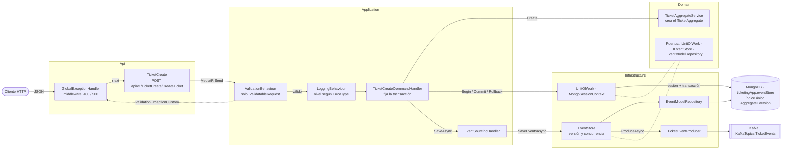
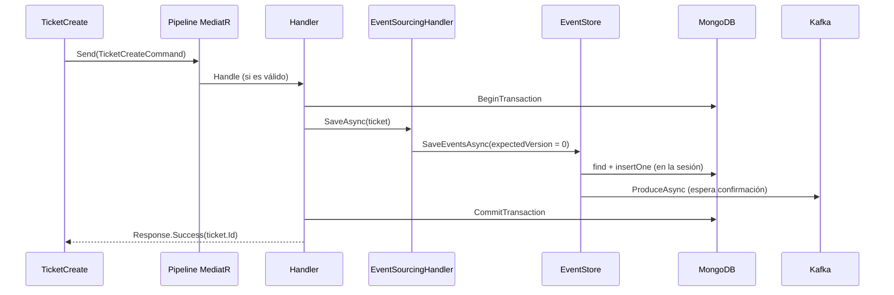

# Arquitectura de Ticketing.Command

[← Volver al README](../../README.md) · [Arquitectura general](../arquitectura.md)

Servicio de escritura: propias capas, base de datos (MongoDB) y `Program.cs`. El *porqué* de cada pieza está en
[*Decisiones técnicas*](decisiones-tecnicas.md); el modelo de agregado, en [*Agregados*](agregados.md).

## Vista de componentes

Cada recuadro es una clase o interfaz real. Los puertos (`I...`) viven en `Domain`: `Application` solo habla con
ellos e `Infrastructure` los implementa (salvo `IEventProducer`, que vive en `Common`).

- **Regla de dependencia:** `Api` → `Application` → `Domain` ← `Infrastructure`. Nada en `Domain` conoce MongoDB.
- **Una transacción por petición:** `UnitOfWork` abre la sesión y la deja en `MongoSessionContext` (`Scoped`); los
  repositorios la leen de ahí, así que `Application` no pasa ninguna sesión.
- **Dos niveles de concurrencia:** `EventStore` compara la versión esperada y el índice único rechaza dos eventos
  con el mismo (agregado, versión).
- **Kafka:** `EventStore` envía cada evento justo después de insertarlo y antes del `Commit`; no comparten
  transacción (ver [*Cuándo se publica*](../mensajeria-kafka.md#cuándo-se-publica)).
- **Pipeline de MediatR:** antes del handler pasan `ValidationBehaviour` y `LoggingBehaviour`; los fallos de
  validación los recoge `GlobalExceptionHandler`.

## Proyectos y dependencias

| Proyecto | Responsabilidad | Referencias | Paquetes |
|---|---|---|---|
| `Api` | Controller, versionado por URL, Swagger, `GlobalExceptionHandler`. Traduce `ErrorType` a HTTP. *Composition root* | `Application`, `Infrastructure` | Asp.Versioning 10.2.1, Swashbuckle 10.3.1 |
| `Application` | Command + handler (MediatR), validador (FluentValidation), behaviours, `ValidationExceptionCustom`, `IValidatableRequest`, `EventSourcingHandler<T>` | `Domain`, `Common` | MediatR 14.2.0, FluentValidation 12.2.0 |
| `Domain` | Agregados y sus servicios, `EventModel`, enums, excepciones y **puertos** | `Common` | — |
| `Infrastructure` | **Adaptadores**: MongoDB (contexto, sesión, UoW, repositorio, `EventStore`, mapeos BSON, índices) y `TicketEventProducer` | `Domain` | MongoDB.Driver 3.12.0; `Confluent.Kafka` llega transitivo |
| `UnitTest` | Tests unitarios (ver [*Tests*](#tests)) | `Api`, `Application`, `Domain` | xUnit 2.9.3, coverlet |

`Api` referencia `Infrastructure` solo para `AddInfrastructureServices` y `EnsureMongoIndexesAsync` en
`Program.cs`. `IMongoSessionContext` e `IMongoBaseRepository<T>` son internas de `Infrastructure`, no puertos.

| Puerto | Implementación |
|---|---|
| `IUnitOfWork` | `UnitOfWork` (`Infrastructure/Repository/UnitOfWork`) |
| `IEventModelRepository` | `EventModelRepository` |
| `IEventStore` | `EventStore` (`Infrastructure/Persistence`) |
| `IEventProducer` (en `Common`) | `TicketEventProducer` |
| `IEventSourcingHandler<T>` | `EventSourcingHandler<T>` (`Application/EventSourcing`) |
| `IAggregateService<T>`, `ITicketAggregateService` | `TicketAggregateService` (`Domain/Services`) |

## Arranque (`Program.cs`)

1. **Servicios**, en orden: `AddMiddleWareService`, `AddControllers`, `AddApplicationServices`,
   `AddInfrastructureServices(configuration)`, `AddVersioning`, `AddSwaggerGen`, `AddOpenApi`.
2. `AddInfrastructureServices` **valida la configuración** (`MongoDbConnection`, `MongoSettings:Database`,
   `KafkaSettings:HostName`/`Port`) y lanza `InvalidOperationException` si falta algo. Registra además los mapeos
   BSON (`MongoClassMaps.Register()`).
3. `Build()`, **`UseMiddlewares()`** (el middleware queda el primero del pipeline) y **`EnsureMongoIndexesAsync`**:
   crea el índice único `ux_aggregate_version` (idempotente, fuera de transacción). La API **no arranca sin
   Mongo**; con Kafka caído sí arranca, porque el `ProducerConfig` no abre conexión.
4. Swagger y su UI solo en `Development`; después `UseHttpsRedirection`, `UseAuthorization`, `MapControllers`.

## Registro en DI

| Servicio | Implementación | Vida |
|---|---|---|
| `GlobalExceptionHandler` | Middleware (`IMiddleware`) | Transient |
| Handlers de MediatR | Escaneo de `Application` | Transient |
| `IPipelineBehavior<,>` | `ValidationBehaviour` y después `LoggingBehaviour` | Transient |
| `IValidator<TicketCreateCommand>` | `TicketCreateValidator` | Scoped |
| `IEventSourcingHandler<>` | `EventSourcingHandler<>` | Scoped |
| `ITicketAggregateService` y `IAggregateService<TicketAggregate>` | `TicketAggregateService` (misma instancia) | Scoped |
| `IMongoClient`, `MongoDbContext`, `ClientSessionOptions` | Cliente, contexto y opciones de sesión | Singleton |
| `IMongoCollection<EventModel>` | `GetCollection<EventModel>("eventStore")` | Singleton |
| `ProducerConfig`, `IEventProducer` | `BootstrapServers = "{HostName}:{Port}"`, `TicketEventProducer` | Singleton |
| `IUnitOfWork`, `IMongoSessionContext`, `IEventModelRepository`, `IEventStore`, `IMongoBaseRepository<>` | UoW, sesión, repositorios y store | Scoped |

`TicketAggregateService` vive en `Domain` pero lo registra `Application`, porque `Domain` no referencia paquetes
de DI. `IMongoClient` es singleton por recomendación del driver; lo que guarda estado de una petición (la sesión)
es `Scoped`.

## Recorrido de una petición

`POST /api/v1/TicketCreate/CreateTicket`

1. **`GlobalExceptionHandler`** envuelve toda la petición.
2. **`TicketCreate`** (controller) envía el `TicketCreateCommand` con `IMediator`.
3. **`ValidationBehaviour`** ejecuta `TicketCreateValidator` (el comando implementa `IValidatableRequest`; sin esa
   marca no se validaría) y **`LoggingBehaviour`** registra la petición. Con datos inválidos lanza
   `ValidationExceptionCustom` y el handler no llega a ejecutarse.
4. **`TicketCreateCommandHandler`** pide a `ITicketAggregateService.Create` un ticket: genera el id (GUID v7),
   construye el `TicketCreatedEvent` y devuelve un `TicketAggregate` en versión 1 con ese evento pendiente
   (ver [*Agregados*](agregados.md#crear-un-ticket-paso-a-paso)).
5. Abre la transacción con **`BeginTransactionAsync`** (sesión de Mongo en `IMongoSessionContext.Current`).
6. **`SaveAsync`** toma los cambios pendientes y la versión previa (aquí 0) y llama a **`IEventStore.SaveEventsAsync`**.
7. **`EventStore`** lee los eventos ya guardados, comprueba la versión (si no, `ConcurrencyException`) y envuelve
   cada evento en un `EventModel` numerado; **`EventModelRepository.AddAsync`** lo inserta con la sesión (el índice
   único también acaba en `ConcurrencyException`). Justo después, **`IEventProducer.ProduceAsync`** lo envía a
   Kafka y espera la confirmación. Detalle en [*Event store*](event-store.md#guardar-eventos).
8. **`CommitTransactionAsync`** confirma; el handler marca los cambios como confirmados y cierra la sesión.
9. Si falla cualquier paso del 6 al 8 (Kafka incluido), el handler hace **`RollbackAsync`** y **relanza**. Lo ya
   enviado a Kafka no se deshace.
10. El handler devuelve `Response<string>.Success(ticket.Id)`; `LoggingBehaviour` lo registra y el controller
    responde **200** con el id en `data`.

### Si algo falla

| Qué falla | Dónde se recoge | Resultado |
|---|---|---|
| Validación (`ValidationExceptionCustom`) | `GlobalExceptionHandler` | **400** con `Response.Invalid`: errores por propiedad. El handler no se ejecuta |
| Excepción no controlada (Mongo, Kafka, concurrencia…) | El handler la relanza tras `RollbackAsync`; la recoge `GlobalExceptionHandler` | **500** con `Response.Fail("Unhandle exception")`; el detalle solo va al log |
| `Response` fallido devuelto como valor | `ToActionResult` | Código según `ErrorType` (tabla siguiente) |

## Sesión y repositorios

`IMongoSessionContext` es la caja con la sesión activa (`Current`) y `UnitOfWork` la orquesta sobre `IMongoClient`:
abre sesión y transacción, la publica en el contexto, confirma o aborta, y al cerrar la libera. Los repositorios
leen la sesión del contexto: operan dentro de la transacción si hay una, y sin ella si no.

| Llamada | Sin sesión activa | Con sesión activa |
|---|---|---|
| `BeginTransactionAsync` | Abre sesión y transacción | Abre otra y sustituye la anterior sin cerrarla |
| `CommitTransactionAsync` | `InvalidOperationException` | Confirma |
| `RollbackAsync` / `Dispose` | No hace nada | Aborta / libera y deja `Current = null` |

`UnitOfWork` es `IDisposable`: el contenedor lo libera al terminar la petición; liberarlo dos veces es inocuo.

## Contrato de respuesta

`Response<T>` (en `Common`) devuelve el resultado como valor: `Success(data)`, `Fail(message, errorType)`,
`NotFound(message)` e `Invalid(errors)` (con `Errors` por propiedad); `IResponse` es su cara no genérica.
`ApiResponseControllerBase.ToActionResult` decide el HTTP:

| `ErrorType` | HTTP |
|---|---|
| `Validation`, `InvalidOperation` | 400 |
| `Unauthorized` | 401 |
| `NotFound` | 404 |
| `Duplicated` | 409 |
| `TimeOut` | 504 |
| `Unexpected`, `None` en un fallo, valor no contemplado | 500 |

Los valores del enum empiezan en 1 a propósito (un `0` indicaría que nadie lo asignó) y se serializan como número.
Es el mismo planteamiento que el del monolito.

## Versionado y Swagger

Por segmento de URL (`api/v{version}/...`) con `Asp.Versioning`: `DefaultApiVersion` 1.0,
`AssumeDefaultVersionWhenUnspecified`, `ReportApiVersions`, solo `UrlSegmentApiVersionReader`, grupo `'v'VVV` y
`SubstituteApiVersionInUrl`. Swagger y su UI solo en `Development`, en `/swagger`.

## Tests

`Ticketing.Command.UnitTest` (xUnit, `[Theory]` con datos reales):

| Clase | Qué comprueba |
|---|---|
| `GlobalExceptionHandlerTests` | Sin excepción respeta el estado y no escribe cuerpo. `ValidationExceptionCustom`: 400, JSON, `ErrorType.Validation` y errores agrupados por propiedad. Otra excepción: 500, JSON, `ErrorType.Unexpected` y **sin filtrar** mensaje ni tipo |
| `TicketCreateValidatorTests` | Datos válidos; un campo inválido falla solo en su propiedad; todos vacíos reportan las tres |
| `TicketAggregateServiceTests` | `Create` da un ticket activo en v1 con un `TicketCreatedEvent` con los datos recibidos; id = id del evento y GUID v7; ids distintos entre llamadas; reproducir los eventos reconstruye el ticket; `OcurredAt` en UTC; `ErrorDetail` nulo se conserva |

Sin tests de los behaviours ni de `Infrastructure`; `Ticketing.Query.UnitTest` solo tiene el test vacío de la
plantilla.
