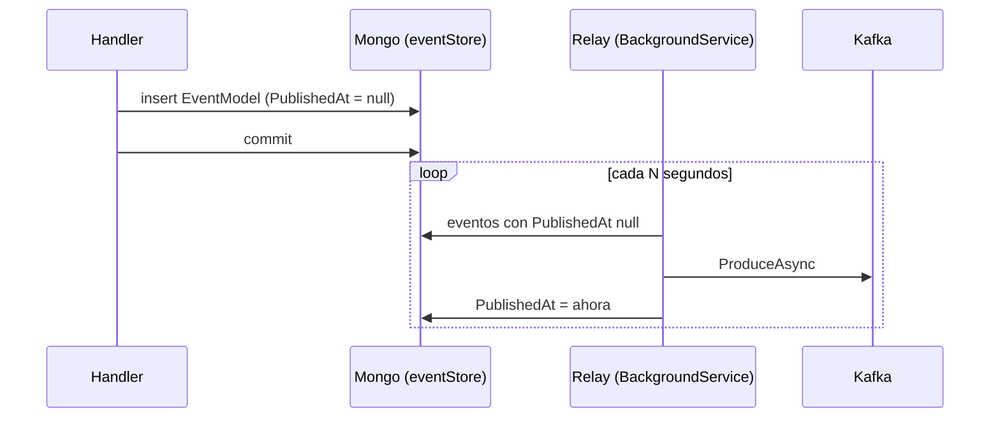

# Mensajería con Kafka

[← Volver al README](../README.md)

Cómo se publican los eventos del event store en Kafka. El **productor** vive en `Ticketing.Command`; el
**consumidor**, en `Ticketing.Query` ([*El consumidor de Kafka*](query/consumidor-kafka.md)). El guardado en
Mongo está en [*Event store*](command/event-store.md).

Mongo guarda la **fuente de verdad**; Kafka **avisa** a otros servicios. Cada evento que `EventStore` guarda se
envía también al topic `KafkaTopics.TicketEvents` (`"KAFKA_TOPIC"`, una constante de `Ticketing.Common`).

## Infraestructura (Docker)

El compose añade tres servicios a MongoDB, en la red `microserviceNetwork`:

| Servicio | Imagen | Puertos | Notas |
|---|---|---|---|
| `zookeeper` | `bitnamilegacy/zookeeper:3.9.1` | `2181` | Coordina el broker (Kafka 3.7 aún no usa KRaft) |
| `kafka` | `bitnamilegacy/kafka:3.7.0` | `9092`, `29092` | Un único broker; topics autocreados |
| `kafka-ui` | `provectuslabs/kafka-ui:v0.7.2` | `8080` | Interfaz web |

**Dos listeners**, porque el cliente usa la dirección que el broker *anuncia*:

| Listener | Anuncia | Lo usa |
|---|---|---|
| `INTERNAL` (`:9092`) | `kafka:9092` | Otros contenedores (Kafka UI) |
| `EXTERNAL` (`:29092`) | `localhost:29092` | Las APIs, que corren en el host |

Por eso `appsettings.json` apunta al puerto **29092**. Ambos son `PLAINTEXT`: solo desarrollo local.

## Configuración

| Servicio | Claves |
|---|---|
| `Command` (`KafkaSettings`) | `HostName = localhost`, `Port = 29092`. Se validan al arrancar; con ellas se registra un `ProducerConfig` *singleton*. No se comprueba que el broker responda. |
| `Query` (`ConsumerConfig`) | `GroupId = TK_CONSUMER`, `BootstrapServers = localhost:29092`, `EnableAutoCommit = false`, `AutoOffsetReset = Earliest`, `AllowAutoCreateTopics = false`. `BootstrapServers` y `GroupId` se validan al arrancar. |

El nombre del topic no es configuración (ver [la decisión](decisiones-tecnicas.md#el-nombre-del-topic-es-una-constante-compartida)).

## El productor

`IEventProducer.ProduceAsync(topic, @event)` (en `Ticketing.Common`, por eso `Common` referencia
`Confluent.Kafka`) se implementa en `TicketEventProducer` (`Infrastructure/Persistence`):

1. Construye un `IProducer<string, string>` con `ProducerConfig`.
2. Serializa el evento a JSON con su **tipo concreto** (`JsonSerializer.Serialize(@event, @event.GetType())`).
   Los nombres salen en PascalCase y `Type` como **número**; el `EventConverter` del consumidor depende de ambas
   cosas.
3. Envía con **clave = `event.Id`** (el id del agregado).
4. Espera la confirmación del broker; si es `NotPersisted`, lanza una excepción.

```
clave:  019...-....
valor:  {"ErrorDetail":"...","Type":1,"Id":"019...-....","OcurredAt":"2026-10-29T10:00:00Z","OcurredBy":"ruben"}
```

(Orientativo: el orden de campos puede variar. `Type` vale `1` para `TicketCreatedEvent` y `2` para
`TicketUpdatedEvent`; **esos números no deben cambiarse**.)

## Cuándo se publica

`EventStore.SaveEventsAsync` publica **dentro del mismo bucle** que inserta en Mongo: por cada evento, primero
`AddAsync` y justo después `ProduceAsync`, todo antes de `CommitTransactionAsync`.

| Qué falla | Resultado |
|---|---|
| El envío a Kafka lanza | `RollbackAsync`: el evento no queda en Mongo y la petición falla. Consistente |
| El `Commit` falla **después** de enviar | El evento está en Kafka y **no** en Mongo |
| Varios eventos y falla el segundo envío | Los anteriores ya están en Kafka; la transacción se aborta |

Mongo y Kafka no comparten transacción (*dual write*). Lo cierra el patrón *Transactional Outbox*: decidido,
pendiente de implementar.

### Pendiente: Transactional Outbox

El propio `eventStore` hace de outbox (sin colección aparte): el caso de uso solo guarda en Mongo y un proceso en
segundo plano publica en Kafka lo ya confirmado. Se aplicará paso a paso:

| Paso | Cambio |
|---|---|
| 1 | `PublishedAt` (`DateTime?`) en `EventModel`: `null` mientras está pendiente de publicar |
| 2 | Métodos nuevos en `IEventModelRepository`: `FindPendingToPublishAsync(batchSize)` (orden `TimeStamp`, `Version`) y `MarkAsPublishedAsync(id, publishedAt)` |
| 3 | Quitar `ProduceAsync` de `EventStore.SaveEventsAsync` (y el `ProducerConfig` que ya no usa) |
| 4 | `BackgroundService` en `Infrastructure` que publica en Kafka los pendientes y los marca; un scope por vuelta (el repositorio es *Scoped*) y corta al primer fallo para no romper el orden por ticket |
| 5 | Índice sobre (`PublishedAt`, `TimeStamp`, `Version`) en `EnsureMongoIndexesAsync` |
| 6 | Actualizar los comentarios de `TicketCreateCommandHandler` que dicen que Kafka se publica en `SaveAsync` |



A tener en cuenta:

- **Datos existentes:** los documentos ya guardados no tienen `PublishedAt` y el relay los reenviaría. Antes de
  arrancarlo, marcarlos: `updateMany({ PublishedAt: { $exists: false } }, { $set: { PublishedAt: new Date() } })`.
- **Entrega *at-least-once*:** si el relay cae entre publicar y marcar, el evento se reenvía. Va en pareja con la
  **idempotencia** del consumidor de `Query` (ver [*Qué falta*](query/consumidor-kafka.md#qué-falta)).
- **Varias instancias de `Command`:** cada una tendría su relay y duplicarían envíos; hoy solo hay una.

## Limitaciones actuales

- **Un productor por mensaje:** se crea y destruye un `IProducer` en cada `ProduceAsync`. Lo habitual es uno
  *singleton* de larga vida.
- **Consumidor sin probar de extremo a extremo** (ver [*Qué falta*](query/consumidor-kafka.md#qué-falta)).
- **Con Kafka caído** la petición falla o espera al *timeout* y no se guarda nada; el tiempo de espera no está
  probado.
- **Sin tests** del productor, del consumidor ni de `EventStore` con Kafka.
- **Particiones y retención:** se usa el topic autocreado. Con una partición el orden está garantizado; con varias,
  solo entre eventos del mismo ticket (por la clave).

## Probarlo

Con el compose y la API de `Command` en marcha, tras un `POST` a `CreateTicket`: en Kafka UI
(`http://localhost:8080`) → *Topics* → `KAFKA_TOPIC` → *Messages* aparece el JSON, y el mismo evento está en
`ticketingApp.eventStore`. Con `Query` en marcha y un empleado cargado, se proyecta en PostgreSQL (ver
[*Cómo probarlo*](query/consumidor-kafka.md#cómo-probarlo)).
