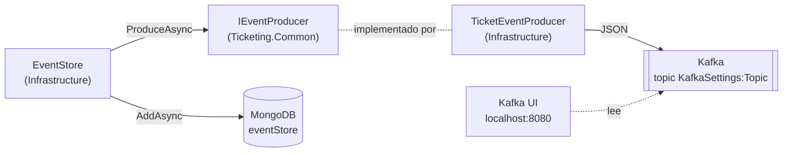
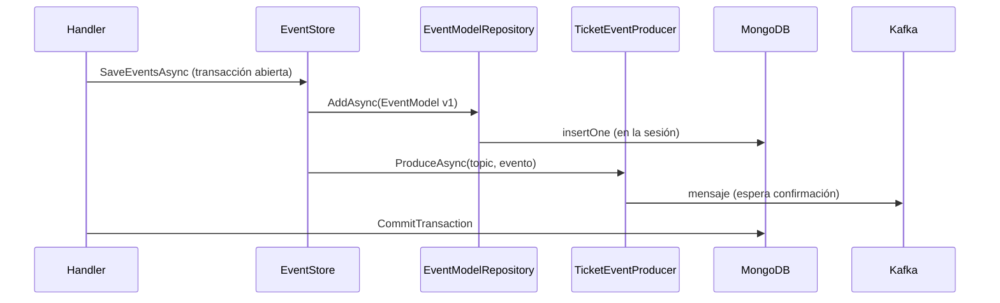

# Mensajería con Kafka

[← Volver al README](../README.md)

Cómo se publican los eventos del event store en Kafka. Hoy solo existe el **lado productor**, en
`Ticketing.Command`: `Ticketing.Query` todavía no consume nada. El guardado en MongoDB está en
[*Event store*](event-store.md); el recorrido completo de la petición, en
[*Arquitectura*](arquitectura.md#recorrido-de-una-petición).

## Idea

Mongo guarda la **fuente de verdad** (la secuencia de eventos de cada agregado). Kafka sirve para **avisar**
a otros servicios de que ha pasado algo: cada evento que `EventStore` guarda en Mongo se envía también a un
topic. El servicio de consulta podrá leer de ese topic para construir su propio modelo de lectura.



## Infraestructura (Docker)

`Docker/docker-compose.yml` añade tres servicios a MongoDB. Los cuatro comparten la red
`microserviceNetwork` (la red `default` del compose).

| Servicio | Imagen | Contenedor | Puertos | Notas |
|---|---|---|---|---|
| `zookeeper` | `bitnamilegacy/zookeeper:3.9.1` | `zookeper` (sin la segunda *e*, tal cual está en el compose) | `2181` | Coordina el broker. Volumen `zookeeper_data`. `ALLOW_ANONYMOUS_LOGIN=yes` |
| `kafka` | `bitnamilegacy/kafka:3.7.0` | `kafka` | `9092`, `29092` | Un único broker (`KAFKA_BROKER_ID: 1`). Volumen `kafka_data`. Topics autocreados |
| `kafka-ui` | `provectuslabs/kafka-ui:v0.7.2` | `kafkaui` | `8080` | Interfaz web para ver topics y mensajes. Cluster `local` |

`zookeeper` y `kafka` llevan `restart: always`, y `kafka` depende de `zookeeper` (y `kafka-ui` de `kafka`).
Esta versión de Kafka (3.7) todavía usa Zookeeper; no es el modo KRaft.

### Dos listeners: uno para contenedores, otro para el host

Un cliente de Kafka se conecta a la dirección inicial, pero después usa la dirección que el broker
**anuncia**. Por eso hay dos listeners con anuncios distintos:

| Listener | Escucha en | Anuncia | Lo usa |
|---|---|---|---|
| `INTERNAL` | `:9092` | `kafka:9092` | Otros contenedores: Kafka UI (`KAFKA_CLUSTERS_0_BOOTSTRAPSERVERS`) y la comunicación entre brokers |
| `EXTERNAL` | `0.0.0.0:29092` | `localhost:29092` | La API, que corre en el host con `dotnet run` |

Si la API usara `kafka:9092`, el nombre `kafka` no resolvería desde el host. Por eso `appsettings.json`
apunta al puerto **29092**.

Los dos listeners son `PLAINTEXT` (`ALLOW_PLAINTEXT_LISTENER: 'yes'`), sin cifrado ni autenticación: solo
para desarrollo local.

## Configuración de la API

[`appsettings.json`](../Ticketing/Ticketing.Command/Ticketing.Command.Api/appsettings.json):

| Clave | Valor | Uso |
|---|---|---|
| `KafkaSettings:HostName` | `localhost` | Host del broker |
| `KafkaSettings:Port` | `29092` | Puerto del listener `EXTERNAL` |
| `KafkaSettings:Topic` | `KAFKA_TOPIC` | Topic al que se envían los eventos |

`AddInfrastructureServices` valida `HostName` y `Port` al arrancar: si falta cualquiera, lanza
`InvalidOperationException` y la API no arranca. Con ellos construye un `ProducerConfig`
(`BootstrapServers = "{HostName}:{Port}"`) y lo registra como *singleton*.

**`Topic` no se valida al arrancar**: `EventStore` lo lee al guardar y, si falta, lanza
`Exception("No se encontró el topic")` en plena petición. Tampoco se comprueba al arrancar que el broker
responda: la API arranca sin Kafka.

`KAFKA_TOPIC` es un valor de ejemplo; el topic se crea solo la primera vez que se produce a él
(`KAFKA_CFG_AUTO_CREATE_TOPICS_ENABLE: 'true'`).

## El productor

| Pieza | Dónde | Papel |
|---|---|---|
| `IEventProducer` | `Ticketing.Common/Common/Producers/Interface` | Contrato: `ProduceAsync(string topic, EventBase @event)` |
| `TicketEventProducer` | `Infrastructure/Persistence` | Implementación con `Confluent.Kafka` |

`IEventProducer` vive en `Ticketing.Common`, no en `Domain` como el resto de puertos, y por eso
`Ticketing.Common.csproj` referencia `Confluent.Kafka` 2.16.0. `Infrastructure` lo recibe de forma
transitiva (a través de `Domain` → `Common`) y no lo declara.

Qué hace `ProduceAsync`:

1. Construye un `IProducer<string, string>` con `ProducerConfig` y serializadores UTF-8.
2. Serializa el evento a JSON con `System.Text.Json`, usando su **tipo concreto**
   (`JsonSerializer.Serialize(@event, @event.GetType())`) para que salgan los campos de
   `TicketCreatedEvent` y no solo los de `EventBase`. Los nombres de propiedad salen tal cual están en C#
   (PascalCase).
3. Envía el mensaje con **clave = `event.Id`** (el id del agregado). Con una sola partición no cambia nada,
   pero si el topic tuviera varias, todos los eventos de un ticket caerían en la misma y conservarían el
   orden.
4. Espera la confirmación del broker (`await producer.ProduceAsync`). Si el estado es `NotPersisted`, lanza
   una excepción con el tipo de evento, el topic y la razón.

Ejemplo de mensaje en el topic:

```
clave:  019...-....
valor:  {"Type":"TicketCreatedEvent","UserName":"ruben","TyperError":"Timeout","DetailError":"...","Id":"019...-...."}
```

(Orientativo: el orden de los campos puede variar.)

## Cuándo se publica

`EventStore.SaveEventsAsync` publica **dentro del mismo bucle** que inserta en Mongo: por cada evento,
primero `IEventModelRepository.AddAsync` y justo después `IEventProducer.ProduceAsync`. Todo ocurre antes de
que el handler llame a `CommitTransactionAsync`.



Consecuencias, que son una limitación conocida y no un error de documentación:

| Qué falla | Resultado |
|---|---|
| El envío a Kafka lanza | El handler hace `RollbackAsync`: el evento no queda en Mongo y la petición falla. Consistente |
| El `Commit` de Mongo falla **después** de enviar | El evento ya está en Kafka y **no** en Mongo. Los consumidores verían un evento que el event store no tiene |
| Hay varios eventos en la misma operación y falla el segundo envío | Los anteriores ya están en Kafka; la transacción de Mongo se aborta |

Mongo y Kafka son dos sistemas sin transacción común (*dual write*). Una forma habitual de cerrarlo es el
patrón *outbox*: guardar el mensaje en Mongo dentro de la misma transacción y publicarlo después con otro
proceso. No está implementado ni decidido; se anota aquí para no olvidar que la garantía de hoy es
"al menos, si Kafka falla no se guarda".

## Limitaciones actuales

- **Un productor por mensaje.** `TicketEventProducer` construye y destruye un `IProducer` en cada
  `ProduceAsync`. Funciona, pero abre una conexión nueva por evento; el uso habitual es un productor de
  larga vida registrado como *singleton*.
- **Sin consumidor.** Nada lee el topic todavía; `Ticketing.Query.Api` no usa Kafka.
- **Con Kafka caído**, la petición no termina bien (el envío falla o espera al *timeout* del cliente) y,
  como la transacción de Mongo sigue abierta, no se guarda nada. No está probado el tiempo de espera.
- **Sin pruebas automáticas** del productor ni de `EventStore` con Kafka.
- **Topic sin validar al arrancar** (ver arriba) y sin configuración propia de particiones o retención: se
  usa el topic autocreado por defecto.

## Probarlo

Con el compose levantado (ver [*Entorno local*](entorno-local.md#2-kafka-y-su-interfaz)), la API en marcha
y un `POST` a `CreateTicket`:

1. Abrir Kafka UI en `http://localhost:8080`.
2. *Topics* → el valor de `KafkaSettings:Topic` → *Messages*: debe aparecer un mensaje con el JSON del
   `TicketCreatedEvent`.
3. El mismo evento está en Mongo, en `ticketingApp.eventStore`.
