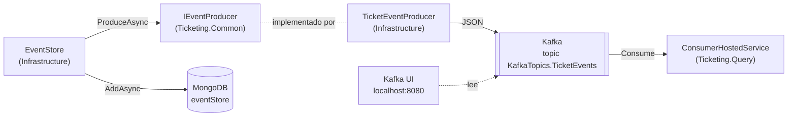
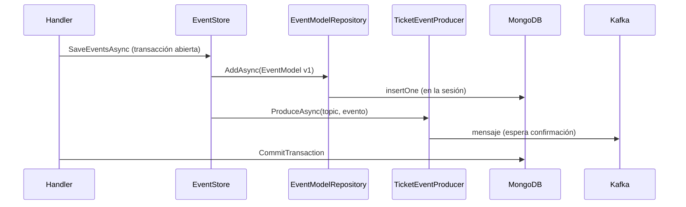

# Mensajería con Kafka

[← Volver al README](../README.md)

Cómo se publican los eventos del event store en Kafka y cómo los recibe el otro servicio. El **productor** vive
en `Ticketing.Command` y el **consumidor** en `Ticketing.Query`; este documento detalla el lado productor y la
infraestructura, y el consumidor tiene su propio documento: [*El consumidor de Kafka y la
proyección*](query/consumidor-kafka.md). El guardado en MongoDB está en
[*Event store*](command/event-store.md); el recorrido completo de la petición, en
[*Arquitectura*](command/arquitectura.md#recorrido-de-una-petición).

## Idea

Mongo guarda la **fuente de verdad** (la secuencia de eventos de cada agregado). Kafka sirve para **avisar**
a otros servicios de que ha pasado algo: cada evento que `EventStore` guarda en Mongo se envía también a un
topic. El servicio de consulta lee de ese topic para construir su propio modelo de lectura.



## Infraestructura (Docker)

`Docker/docker-compose.yml` añade tres servicios a MongoDB. Los cuatro comparten la red
`microserviceNetwork` (la red `default` del compose).

| Servicio | Imagen | Contenedor | Puertos | Notas |
|---|---|---|---|---|
| `zookeeper` | `bitnamilegacy/zookeeper:3.9.1` | `zookeper` (sin la segunda *e*, tal cual está en el compose) | `2181` | Coordina el broker. Volumen `zookeeper_data`. `ALLOW_ANONYMOUS_LOGIN=yes` |
| `kafka` | `bitnamilegacy/kafka:3.7.0` | `kafka` | `9092`, `29092` | Un único broker (`KAFKA_BROKER_ID: 1`). Volumen `kafka_data`. Topics autocreados |
| `kafka-ui` | `provectuslabs/kafka-ui:v0.7.2` | `kafkaui` | `8080` | Interfaz web para ver topics y mensajes. Cluster `local` |

`zookeeper` y `kafka` llevan `restart: always`, y `kafka` depende de `zookeeper` (y `kafka-ui` de `kafka`).
Esta versión de Kafka (3.7) todavía usa Zookeeper; no es el modo KRaft.

### Dos listeners: uno para contenedores, otro para el host

Un cliente de Kafka se conecta a la dirección inicial, pero después usa la dirección que el broker
**anuncia**. Por eso hay dos listeners con anuncios distintos:

| Listener | Escucha en | Anuncia | Lo usa |
|---|---|---|---|
| `INTERNAL` | `:9092` | `kafka:9092` | Otros contenedores: Kafka UI (`KAFKA_CLUSTERS_0_BOOTSTRAPSERVERS`) y la comunicación entre brokers |
| `EXTERNAL` | `0.0.0.0:29092` | `localhost:29092` | La API, que corre en el host con `dotnet run` |

Si la API usara `kafka:9092`, el nombre `kafka` no resolvería desde el host. Por eso `appsettings.json`
apunta al puerto **29092**.

Los dos listeners son `PLAINTEXT` (`ALLOW_PLAINTEXT_LISTENER: 'yes'`), sin cifrado ni autenticación: solo
para desarrollo local.

## Configuración

### El nombre del topic

El topic **no es configuración**: es una constante en `Ticketing.Common`,
`KafkaTopics.TicketEvents = "KAFKA_TOPIC"`. Productor y consumidor tienen que coincidir exactamente, y si cada
servicio lo leyera de su `appsettings` se podrían desincronizar sin ningún error: el consumidor se suscribiría
a un topic vacío. A cambio, no se puede cambiar por entorno sin recompilar, y renombrarlo obliga a recompilar
los dos servicios. `KAFKA_TOPIC` es un valor de ejemplo; el topic se crea solo la primera vez que se produce a
él (`KAFKA_CFG_AUTO_CREATE_TOPICS_ENABLE: 'true'`).

### Productor (`Ticketing.Command.Api`)

[`appsettings.json`](../Ticketing/Ticketing.Command/Ticketing.Command.Api/appsettings.json):

| Clave | Valor | Uso |
|---|---|---|
| `KafkaSettings:HostName` | `localhost` | Host del broker |
| `KafkaSettings:Port` | `29092` | Puerto del listener `EXTERNAL` |

`AddInfrastructureServices` valida `HostName` y `Port` al arrancar: si falta cualquiera, lanza
`InvalidOperationException` y la API no arranca. Con ellos construye un `ProducerConfig`
(`BootstrapServers = "{HostName}:{Port}"`) y lo registra como *singleton*. Tampoco se comprueba al arrancar que
el broker responda: la API arranca sin Kafka.

### Consumidor (`Ticketing.Query.Api`)

[`appsettings.json`](../Ticketing/Ticketing.Query/Ticketing.Query.Api/appsettings.json), sección
`ConsumerConfig`, que se enlaza directamente a la clase `ConsumerConfig` de Confluent:

| Clave | Valor | Uso |
|---|---|---|
| `GroupId` | `TK_CONSUMER` | Grupo de consumidores; Kafka guarda los offsets por grupo |
| `BootstrapServers` | `localhost:29092` | Listener `EXTERNAL`, porque la API corre en el host |
| `EnableAutoCommit` | `false` | El offset se confirma a mano, después de proyectar el evento |
| `AutoOffsetReset` | `Earliest` | Sin offset guardado, lee desde el principio del topic |
| `AllowAutoCreateTopics` | `false` | El consumidor no crea topics |

`BootstrapServers` y `GroupId` se validan al arrancar. Qué hace cada ajuste, en
[*El consumidor de Kafka*](query/consumidor-kafka.md#conceptos-de-kafka-que-usa-este-código).

## El productor

| Pieza | Dónde | Papel |
|---|---|---|
| `IEventProducer` | `Ticketing.Common/Common/Producers/Interface` | Contrato: `ProduceAsync(string topic, EventBase @event)` |
| `TicketEventProducer` | `Infrastructure/Persistence` | Implementación con `Confluent.Kafka` |

`IEventProducer` vive en `Ticketing.Common`, no en `Domain` como el resto de puertos, y por eso
`Ticketing.Common.csproj` referencia `Confluent.Kafka` 2.16.0. `Infrastructure` lo recibe de forma
transitiva (a través de `Domain` → `Common`) y no lo declara.

Qué hace `ProduceAsync`:

1. Construye un `IProducer<string, string>` con `ProducerConfig` y serializadores UTF-8.
2. Serializa el evento a JSON con `System.Text.Json`, usando su **tipo concreto**
   (`JsonSerializer.Serialize(@event, @event.GetType())`) para que salgan los campos de
   `TicketCreatedEvent` y no solo los de `EventBase`. Los nombres de propiedad salen tal cual están en C#
   (PascalCase) y `Type`, que es un enum, sale como **número**. El consumidor depende de las dos cosas: su
   `EventConverter` busca la propiedad `Type`, con esa capitalización y como entero.
3. Envía el mensaje con **clave = `event.Id`** (el id del agregado). Con una sola partición no cambia nada,
   pero si el topic tuviera varias, todos los eventos de un ticket caerían en la misma y conservarían el
   orden.
4. Espera la confirmación del broker (`await producer.ProduceAsync`). Si el estado es `NotPersisted`, lanza
   una excepción con el tipo de evento, el topic y la razón.

Ejemplo de mensaje en el topic:

```
clave:  019...-....
valor:  {"Type":1,"UserName":"ruben","DetailError":"...","Id":"019...-...."}
```

(Orientativo: el orden de los campos puede variar. `Type` vale `1` para `TicketCreatedEvent` y `2` para
`TicketUpdatedEvent`; son los valores de `eEventType` en `Ticketing.Common`. **Esos números no deben
cambiarse:** ya viajan por Kafka.)

## Cuándo se publica

`EventStore.SaveEventsAsync` publica **dentro del mismo bucle** que inserta en Mongo: por cada evento,
primero `IEventModelRepository.AddAsync` y justo después `IEventProducer.ProduceAsync`. Todo ocurre antes de
que el handler llame a `CommitTransactionAsync`.



Consecuencias, que son una limitación conocida y no un error de documentación:

| Qué falla | Resultado |
|---|---|
| El envío a Kafka lanza | El handler hace `RollbackAsync`: el evento no queda en Mongo y la petición falla. Consistente |
| El `Commit` de Mongo falla **después** de enviar | El evento ya está en Kafka y **no** en Mongo. Los consumidores verían un evento que el event store no tiene |
| Hay varios eventos en la misma operación y falla el segundo envío | Los anteriores ya están en Kafka; la transacción de Mongo se aborta |

Mongo y Kafka son dos sistemas sin transacción común (*dual write*). Una forma habitual de cerrarlo es el
patrón *outbox*: guardar el mensaje en Mongo dentro de la misma transacción y publicarlo después con otro
proceso. No está implementado ni decidido; se anota aquí para no olvidar que la garantía de hoy es
"al menos, si Kafka falla no se guarda".

## Limitaciones actuales

- **Un productor por mensaje.** `TicketEventProducer` construye y destruye un `IProducer` en cada
  `ProduceAsync`. Funciona, pero abre una conexión nueva por evento; el uso habitual es un productor de
  larga vida registrado como *singleton*.
- **Consumidor sin probar de extremo a extremo.** `Ticketing.Query` ya tiene un consumidor que proyecta los
  eventos sobre PostgreSQL, pero el flujo completo no se ha ejecutado. Qué falta, en
  [*El consumidor de Kafka*](query/consumidor-kafka.md#qué-falta).
- **Con Kafka caído**, la petición no termina bien (el envío falla o espera al *timeout* del cliente) y,
  como la transacción de Mongo sigue abierta, no se guarda nada. No está probado el tiempo de espera.
- **Sin pruebas automáticas** del productor, del consumidor ni de `EventStore` con Kafka.
- **Sin configuración propia de particiones o retención:** se usa el topic autocreado por defecto. No he
  comprobado cuántas particiones tiene; con una sola, el orden entre eventos está garantizado.
- **Orden entre eventos.** La clave del mensaje es el id del agregado, así que los eventos de un mismo ticket
  conservarían el orden con varias particiones, pero no hay orden garantizado entre tickets distintos.

## Probarlo

Con el compose levantado (ver [*Entorno local*](entorno-local.md#kafka-y-su-interfaz)), la API en marcha
y un `POST` a `CreateTicket`:

1. Abrir Kafka UI en `http://localhost:8080`.
2. *Topics* → `KAFKA_TOPIC` → *Messages*: debe aparecer un mensaje con el JSON del `TicketCreatedEvent`.
3. El mismo evento está en Mongo, en `ticketingApp.eventStore`.
4. Con `Ticketing.Query` en marcha y un empleado cargado, el evento se proyecta en PostgreSQL (ver
   [*Cómo probarlo*](query/consumidor-kafka.md#cómo-probarlo)).
