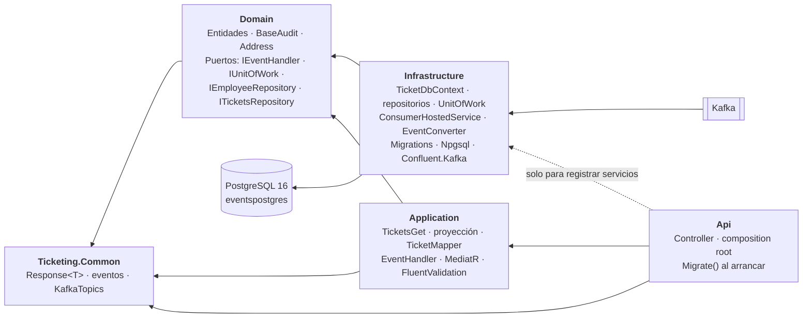
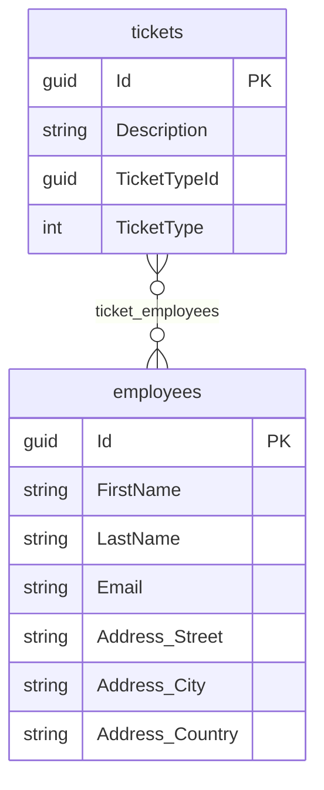

# Arquitectura de Ticketing.Query

[← Volver al README](../../README.md) · [Arquitectura general](../arquitectura.md)

Servicio de **lectura**, independiente de `Ticketing.Command`: propias capas, `Program.cs` y base de datos
(PostgreSQL). No usa event sourcing: el estado vive en tablas que se rellenan **proyectando** los eventos que
llegan por Kafka. Decisiones en [*Decisiones técnicas*](decisiones-tecnicas.md); consumidor en
[*El consumidor de Kafka*](consumidor-kafka.md).

## Qué hay

- `Api`, `Application`, `Domain`, `Infrastructure` y `UnitTest`; PostgreSQL 16 con EF Core y Npgsql.
- Modelo: `Ticket`, `Employee`, `BaseAudit` y `Address`.
- `ConsumerHostedService` lee el topic y proyecta `TicketCreatedEvent` y `TicketUpdatedEvent`.
- Casos de uso con MediatR: dos comandos de proyección (`TicketCreated`, `TicketUpdated`) y una consulta
  (`TicketsGet`), expuesta en `GET api/v1/Ticket/AllTickets`.
- Migración `Initial`, aplicada al arrancar, **desfasada respecto al modelo** (ver [*Migraciones*](#migraciones)).

## Dependencias entre proyectos



- `Domain` no tiene paquetes de EF Core; referencia `Common` porque `Ticket` usa `eEventType`.
- `Application` habla con la base de datos solo por los puertos de `Domain`.
- El consumidor está en `Infrastructure` porque es un adaptador: traduce un mensaje de Kafka a una llamada al
  puerto `IEventHandler` (en `Domain`, implementado por `Application`).
- `Microsoft.EntityFrameworkCore.Design` está en `Api` (proyecto de inicio) e `Infrastructure`, con
  `PrivateAssets=all`, para que `dotnet ef` funcione.

## Árbol de carpetas

```
Ticketing.Query/
├── Ticketing.Query.Api/             Controllers (TicketController), Modules/Versioning, Program.cs, appsettings.json
├── Ticketing.Query.Application/
│   ├── Feature/Events/              EventHandler (un On por tipo de evento)
│   ├── Feature/Commands/            TicketCreated/ · TicketUpdated/  (Command · CommandHandler · Validator)
│   ├── Feature/Queries/TicketsGet/  Query · QueryHandler · Validator
│   ├── Dto/                         TicketDto
│   └── Mapping/                     TicketMapper
├── Ticketing.Query.Domain/          Entities (Ticket, Employee, Audit/BaseAudit), Interfaces, ValueObjects/Address
├── Ticketing.Query.Infrastructure/  Consumers, Converters, Data/TicketDbContext, Persistence (config por entidad), Repository, Migrations
└── Ticketing.Query.UnitTest/
```

## Modelo de datos



- **`BaseAudit`** (base de `Ticket` y `Employee`): `Id`, `CreatedAt/By`, `LastUpdatedAt/By`, `IsDeleted` y
  `DeletedAt/By`.
- **`Ticket.TicketType`** es el enum `eEventType` (nullable, guardado como entero): el tipo del **evento** que
  originó el ticket. **`TicketTypeId`** es un `Guid?` sin clave foránea con el `Id` del evento. Los nombres no
  reflejan ese contenido (ver [*Qué falta*](consumidor-kafka.md#qué-falta)).
- **`Address`**: value object (`[ComplexType]`) sin `Id`, con columnas en `employees`; setters privados y
  constructor que valida y recorta.
- **Ticket ↔ Employee**: muchos a muchos con `ticket_employees`, sin clase propia. Tablas en minúsculas y plural.
- **Los empleados ya existen**: ningún evento los crea (ver
  [*Los empleados ya existen*](consumidor-kafka.md#los-empleados-ya-existen)).

## Infraestructura

`TicketDbContext` se registra con `AddDbContext` y `UseNpgsql(PostgresConnection)`; las configuraciones de entidad
se descubren con `ApplyConfigurationsFromAssembly`. `AddInfrastructureServices` registra además `IUnitOfWork`,
`IEmployeeRepository`, el `ConsumerConfig` (enlazado y validado) y el consumidor como hosted service (pendiente:
registrar `ITicketsRepository`). La cadena `PostgresConnection` va vacía en `appsettings.json` y se aporta por
secretos (ver [*Entorno local*](../entorno-local.md#3-ticketingquery)).

## Migraciones

`Program.cs` llama a `context.Database.Migrate()` al arrancar. Para crear una:

```bash
dotnet ef migrations add NombreMigracion \
  --project Ticketing.Query.Infrastructure \
  --startup-project Ticketing.Query.Api
```

> **La migración `Initial` está desfasada.** Se generó cuando existía una entidad `TicketType` (tabla
> `ticket_types`, `TicketTypeId` entero con FK); ahora `TicketType` es un enum y `TicketTypeId` un `Guid?` sin FK.
> Hay que regenerarla (si nunca se aplicó) o añadir una nueva encima (si ya se aplicó). Hasta entonces,
> `Migrate()` crearía un esquema distinto del que espera el modelo.

## Capa de aplicación y API

- **Proyección:** `TicketCreatedCommand` (lo envía `EventHandler.On(TicketCreatedEvent)`) y `TicketUpdatedCommand`
  (`On(TicketUpdatedEvent)`), ambos `IRequest<Response<string>>` con su handler.
- **Lectura:** `TicketGetQuery` → `Response<List<TicketDto>>`. `TicketGetQueryHandler` lee todos los tickets con
  `_unitOfWork._ticketsRepo.GetAllAsync()`, devuelve `NotFound` si no hay ninguno y los convierte con
  `TicketMapper.MappingToDto` (`TicketDto`: `Description`, `TicketTypeId`, `TicketType`, `LastUpdatedAt`,
  `LastUpdatedBy`). `GET api/v1/Ticket/AllTickets` envía la consulta por MediatR.
- **Endpoints quitados:** `ReadTicket` y `UpdateTicket` ejecutaban comandos de proyección. Solo el consumidor de
  Kafka debe lanzarlos: por HTTP se saltarían el event store y el modelo de lectura dejaría de reflejar los
  eventos reales. Quedan comentados en `TicketController` como referencia.
- `AddApplicationServices()` registra MediatR, los validadores e `IEventHandler` → `EventHandler`. No hay
  `ValidationBehaviour` en `Query` (el de `Command` no se ha trasladado), así que los validadores están vacíos y no
  se ejecutan. El versionado (`api/v{version:apiVersion}/...`) se registra con `AddVersioning()` en `Program.cs`.
- **Peculiaridades sin resolver:** `AllTickets` es un `GET` que lee `TicketGetQuery` del body (`[FromBody]`), su
  método se llama `Create`, el handler exige un `Id` GUID válido sin usarlo y `UserName`, `Type` y `DetailError` de
  la query no se usan. `TicketUpdatedCommandHandler` copia al de creación (añade un ticket en vez de actualizar
  uno); si "actualizar" debe modificar el ya proyectado, falta definir cómo localizarlo (por `TicketTypeId`).

## Pendiente

- Adaptar `EventHandler.On(TicketCreatedEvent)` al cambio de contrato (el usuario viaja en `OcurredBy`).
- Corregir el mensaje de excepción de `On(TicketUpdatedEvent)`, que nombra `TicketCreatedEvent`.
- Regenerar o añadir la migración.
- Implementar `TicketsRepository` y decidir qué hace de verdad `TicketGetQuery` (filtros, paginación).
- Probar de extremo a extremo la proyección y cerrar lo que falta en el consumidor (errores, idempotencia).
- Tests de `Ticketing.Query.UnitTest`.
