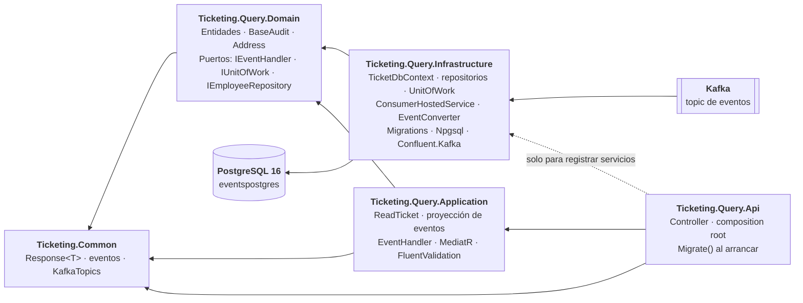
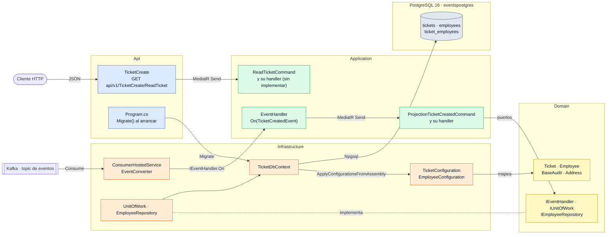
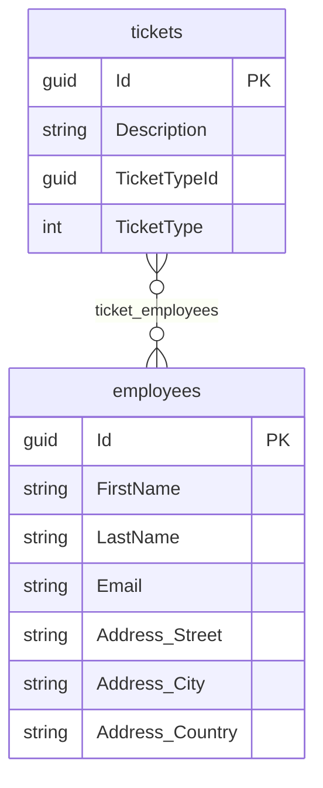

# Arquitectura de Ticketing.Query

[← Volver al README](../../README.md) · [Arquitectura general](../arquitectura.md)

Microservicio de **lectura**, independiente de `Ticketing.Command`: tiene sus propias capas, su propio
`Program.cs` y su propia base de datos (PostgreSQL), y no referencia ningún proyecto del otro servicio. No usa
event sourcing: el estado vive en tablas relacionales, que se rellenan **proyectando** los eventos que llegan por
Kafka. Cómo encaja con `Command`, en la [arquitectura general](../arquitectura.md); las decisiones, en
[*Decisiones técnicas*](decisiones-tecnicas.md); el consumidor, en
[*El consumidor de Kafka y la proyección*](consumidor-kafka.md).

## Qué hay

| Antes | Ahora |
|---|---|
| Solo `Ticketing.Query.Api` | `Api`, `Application`, `Domain`, `Infrastructure` y `UnitTest` |
| Sin base de datos | PostgreSQL 16 con EF Core y Npgsql |
| Sin modelo | `Ticket`, `Employee`, `BaseAudit` y `Address` |
| Sin consumo de eventos | `ConsumerHostedService` lee el topic y proyecta `TicketCreatedEvent` en PostgreSQL |
| Sin casos de uso | Feature `ReadTicket` (sin implementar) y proyección `ProjectionTicketCreated` con MediatR |
| Sin migraciones | Migración `Initial`, aplicada al arrancar, **desfasada respecto al modelo** (ver [*Migraciones*](#migraciones)) |

## Dependencias entre proyectos

Las dependencias apuntan hacia dentro.



- `Domain` no tiene paquetes de EF Core. Referencia `Ticketing.Common` porque `Ticket` usa el enum
  `eEventType` y los puertos usan los eventos.
- `Application` referencia `Domain` y `Ticketing.Common`. Habla con la base de datos solo a través de los
  puertos de `Domain` (`IUnitOfWork`, `IEmployeeRepository`).
- `Infrastructure` contiene el consumidor porque es un adaptador: traduce un mensaje de Kafka a una llamada
  sobre el puerto `IEventHandler`, que vive en `Domain` y que implementa `Application`.
- `Microsoft.EntityFrameworkCore.Design` está en `Api` (proyecto de inicio) e `Infrastructure`, con
  `PrivateAssets=all`, para que `dotnet ef` funcione con las migraciones en `Infrastructure`.

## Vista de componentes

Cada recuadro es una clase o un conjunto de clases reales de `Ticketing.Query`. Hay dos entradas: el
**consumidor** (que escribe, proyectando eventos) y el **controller** (que lee, y está sin implementar).



## Árbol de carpetas

```
Ticketing.Query/
├── Ticketing.Query.Api/
│   ├── Controllers/                 TicketCreate, ActionResultController
│   ├── Modules/Versioning/
│   ├── Program.cs                   Secretos, DI, Migrate(), pipeline
│   └── appsettings.json             ConnectionStrings:PostgresConnection · ConsumerConfig
├── Ticketing.Query.Application/
│   ├── ConfigurationServices.cs     AddApplicationServices(): MediatR, validadores, IEventHandler
│   └── Feature/
│       ├── Events/                  EventHandler (orquesta un On por tipo de evento)
│       ├── Tickets/                 ProjectionTicketCreated: Command · CommandHandler · Validator
│       └── ReadTicket/              Command · CommandHandler · Validator
├── Ticketing.Query.Domain/
│   ├── Entities/                    Ticket · Employee
│   │   └── Audit/BaseAudit.cs
│   ├── Interfaces/                  IEventHandler · IUnitOfWork · IEmployeeRepository · IBaseRepository
│   └── ValueObjects/Address.cs
├── Ticketing.Query.Infrastructure/
│   ├── ConfigurationServices.cs     AddInfrastructureServices(): DbContext, ConsumerConfig, consumidor
│   ├── Consumers/                   ConsumerHostedService
│   ├── Converters/                  EventConverter
│   ├── Data/TicketDbContext.cs
│   ├── Persistence/                 Una IEntityTypeConfiguration por entidad
│   ├── Repository/                  UnitOfWork · EmployeeRepository
│   └── Migrations/
└── Ticketing.Query.UnitTest/
```

## Modelo de datos



- **`BaseAudit`** (base de `Ticket` y `Employee`): `Id` (`Guid`), `CreatedAt`/`CreatedBy`,
  `LastUpdatedAt`/`LastUpdatedBy`, `IsDeleted` y `DeletedAt`/`DeletedBy`. Las fechas de modificación y
  borrado son `DateTime?`.
- **`Ticket.TicketType`** es el enum `eEventType` de `Ticketing.Common` (nullable), no una entidad ni una tabla:
  se guarda como entero. Sus valores son `TicketCreatedEvent` y `TicketUpdatedEvent`, es decir, el tipo del
  **evento** que originó el ticket.
- **`Ticket.TicketTypeId`** es un `Guid?` sin clave foránea. La proyección le asigna el `Id` del evento. Los
  dos nombres no reflejan bien ese contenido; está anotado en [*Qué falta*](consumidor-kafka.md#qué-falta).
- **`Address`**: value object (`[ComplexType]`) sin `Id`; sus columnas van en la tabla `employees`. Setters
  privados y constructor público que valida y recorta los valores.
- **Ticket ↔ Employee**: muchos a muchos con la tabla intermedia `ticket_employees`, sin clase propia.
- Tablas en minúsculas y plural: `tickets`, `employees`, `ticket_employees`.
- **Los empleados ya existen:** ningún evento crea empleados. El consumidor solo les añade tickets (ver
  [*Los empleados ya existen*](consumidor-kafka.md#los-empleados-ya-existen)).

## Infraestructura

`TicketDbContext` se registra con `AddDbContext` y `UseNpgsql(PostgresConnection)`. Las configuraciones de
entidad se descubren con `ApplyConfigurationsFromAssembly`. Además, `AddInfrastructureServices` registra
`IUnitOfWork`, `IEmployeeRepository`, el `ConsumerConfig` (enlazado y validado) y el consumidor como hosted
service.

La cadena `PostgresConnection` no se versiona: `appsettings.json` la declara vacía y se aporta por secretos.
Cómo levantar PostgreSQL y la API, en [*Entorno local*](../entorno-local.md#3-ticketingquery).

## Migraciones

`Program.cs` llama a `context.Database.Migrate()` al arrancar. Para crear una migración:

```bash
dotnet ef migrations add NombreMigracion \
  --project Ticketing.Query.Infrastructure \
  --startup-project Ticketing.Query.Api
```

> **La migración `Initial` está desfasada.** Se generó cuando el modelo tenía una entidad `TicketType` (tabla
> `ticket_types`, `TicketTypeId` entero con clave foránea). Ahora `TicketType` es un enum y `TicketTypeId` es un
> `Guid?` sin clave foránea. Hay que regenerar la migración (si `Initial` nunca se aplicó a la base) o añadir
> una nueva encima (si ya se aplicó). Hasta entonces, `Migrate()` crearía un esquema distinto del que espera el
> modelo.

## Capa de aplicación y API

- **Proyección:** `ProjectionTicketCreatedCommand` → `IRequest<Response<string>>`, con su handler. Lo envía
  `EventHandler` cuando el consumidor entrega un `TicketCreatedEvent`.
- **Lectura:** `ReadTicketCommand` → `IRequest<Response<bool>>`, con `ReadTicketCommandHandler` y
  `ReadTicketValidator`. `GET api/v1/TicketCreate/ReadTicket` envía el comando por MediatR.
- `AddApplicationServices()` registra MediatR (handlers del ensamblado), los validadores y
  `IEventHandler` → `EventHandler`. No hay un `ValidationBehaviour` en el pipeline, así que los validadores
  están registrados pero no se ejecutan.

## Pendiente

- Regenerar o añadir la migración (ver arriba).
- Implementar `ReadTicket` (el handler lanza `NotImplementedException`).
- Probar de extremo a extremo la proyección del consumidor y cerrar lo que falta en él: política de errores,
  idempotencia y `On(TicketUpdatedEvent)`. Detalle en [*El consumidor de Kafka*](consumidor-kafka.md#qué-falta).
- Tests de `Ticketing.Query.UnitTest`.
