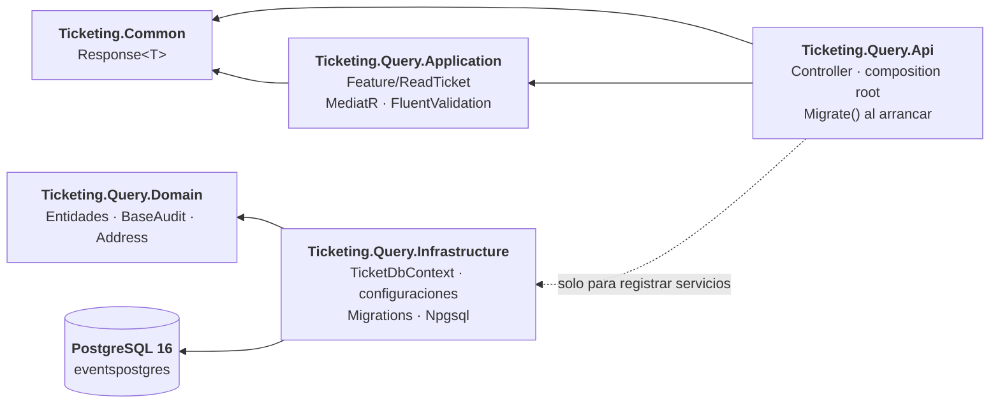
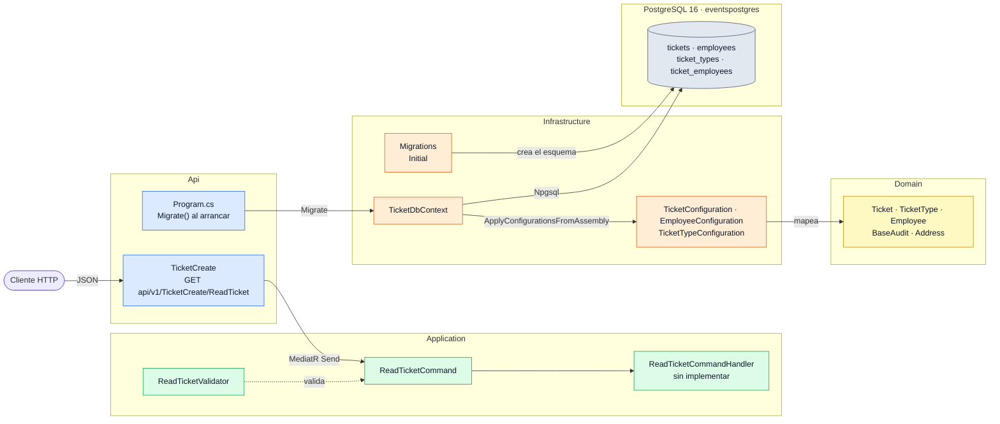
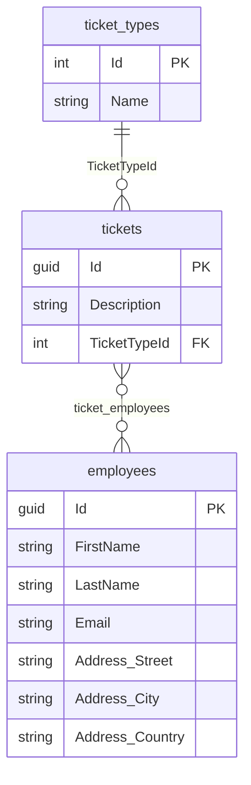

# Arquitectura de Ticketing.Query

[← Volver al README](../../README.md) · [Arquitectura general](../arquitectura.md)

Microservicio de **lectura**, independiente de `Ticketing.Command`: tiene sus propias capas, su propio
`Program.cs` y su propia base de datos (PostgreSQL), y no referencia ningún proyecto del otro servicio. No usa
event sourcing: el estado vive en tablas relacionales. Cómo encaja con `Command`, en la
[arquitectura general](../arquitectura.md); las decisiones, en [*Decisiones técnicas*](decisiones-tecnicas.md).

## Qué hay

| Antes | Ahora |
|---|---|
| Solo `Ticketing.Query.Api` | `Api`, `Application`, `Domain`, `Infrastructure` y `UnitTest` |
| Sin base de datos | PostgreSQL 16 con EF Core y Npgsql |
| Sin modelo | `Ticket`, `TicketType`, `Employee`, `BaseAudit` y `Address` |
| Sin casos de uso | Feature `ReadTicket` (comando, handler y validador) con MediatR |
| Sin migraciones | Migración `Initial` aplicada al arrancar |

## Dependencias entre proyectos

Las dependencias apuntan hacia dentro.



- `Domain` no tiene paquetes de EF Core.
- `Application` referencia solo `Ticketing.Common`.
- `Microsoft.EntityFrameworkCore.Design` está en `Api` (proyecto de inicio) e `Infrastructure`, con
  `PrivateAssets=all`, para que `dotnet ef` funcione con las migraciones en `Infrastructure`.

## Vista de componentes

Cada recuadro es una clase o un conjunto de clases reales de `Ticketing.Query`. El handler de `ReadTicket`
todavía no usa `TicketDbContext`: hoy la base de datos solo se toca al arrancar, con `Migrate()`.



## Árbol de carpetas

```
Ticketing.Query/
├── Ticketing.Query.Api/
│   ├── Controllers/                 TicketCreate, ActionResultController
│   ├── Modules/Versioning/
│   ├── Program.cs                   Secretos, DI, Migrate(), pipeline
│   └── appsettings.json             ConnectionStrings:PostgresConnection
├── Ticketing.Query.Application/
│   ├── ApplicationServices.cs       AddApplicationServices()
│   └── Feature/ReadTicket/          Command · CommandHandler · Validator
├── Ticketing.Query.Domain/
│   ├── Entities/                    Ticket · TicketType · Employee
│   │   └── Audit/BaseAudit.cs
│   └── ValueObjects/Address.cs
├── Ticketing.Query.Infrastructure/
│   ├── ConfigurationServices.cs     AddInfrastructureServices()
│   ├── Data/TicketDbContext.cs
│   ├── Persistence/                 Una IEntityTypeConfiguration por entidad
│   └── Migrations/
└── Ticketing.Query.UnitTest/
```

## Modelo de datos



- **`BaseAudit`** (base de `Ticket` y `Employee`): `Id` (`Guid`), `CreatedAt`/`CreatedBy`,
  `LastUpdatedAt`/`LastUpdatedBy`, `IsDeleted` y `DeletedAt`/`DeletedBy`. Las fechas de modificación y
  borrado son `DateTime?`.
- **`TicketType`**: catálogo con `Id` entero y sin auditoría.
- **`Address`**: value object (`[ComplexType]`) sin `Id`; sus columnas van en la tabla `employees`. Setters
  privados y constructor público que valida y recorta los valores.
- **Ticket ↔ Employee**: muchos a muchos con la tabla intermedia `ticket_employees`, sin clase propia.
- Tablas en minúsculas y plural: `tickets`, `employees`, `ticket_types`, `ticket_employees`.

## Infraestructura

`TicketDbContext` se registra con `AddDbContext` y `UseNpgsql(PostgresConnection)`. Las configuraciones de
entidad se descubren con `ApplyConfigurationsFromAssembly`.

La cadena `PostgresConnection` no se versiona: `appsettings.json` la declara vacía y se aporta por secretos.
Cómo levantar PostgreSQL y la API, en [*Entorno local*](../entorno-local.md#3-ticketingquery).

## Migraciones

`Program.cs` llama a `context.Database.Migrate()` al arrancar. Para crear una migración:

```bash
dotnet ef migrations add NombreMigracion \
  --project Ticketing.Query.Infrastructure \
  --startup-project Ticketing.Query.Api
```

## Capa de aplicación y API

- `ReadTicketCommand` → `IRequest<Response<bool>>`, con `ReadTicketCommandHandler` y `ReadTicketValidator`.
- `GET api/v1/TicketCreate/ReadTicket` envía el comando por MediatR.

## Pendiente

- Registrar MediatR y los validadores en `AddApplicationServices()`.
- Implementar `ReadTicket` (el handler lanza `NotImplementedException`).
- Consumidor de Kafka que proyecte `TicketCreatedEvent` sobre `tickets` (el productor está en
  [*Mensajería con Kafka*](../mensajeria-kafka.md)).
- Tests de `Ticketing.Query.UnitTest`.
