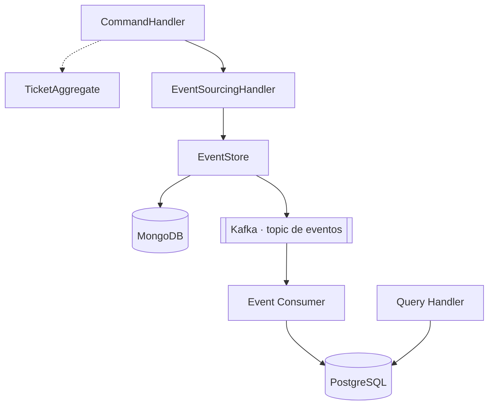
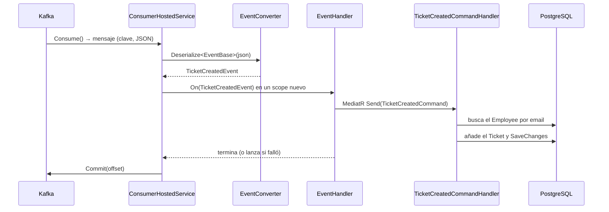

# El consumidor de Kafka y la proyección

[← Volver al README](../../README.md) · [Arquitectura de Query](arquitectura.md) · [Mensajería con Kafka](../mensajeria-kafka.md)

Cómo `Ticketing.Query` recibe los eventos de `Ticketing.Command` y los convierte en filas de PostgreSQL: la
escritura termina en Kafka y la lectura empieza ahí.

> **Estado.** El flujo completo (Command publica → Kafka → Query proyecta en PostgreSQL) **no se ha probado de
> extremo a extremo**. Ver [*Qué falta*](#qué-falta) y [*Cómo probarlo*](#cómo-probarlo).

## La idea de partida

El diseño es el del curso: escritura y lectura separadas y unidas por un topic.

| Pieza del esquema | Clase real | Servicio |
|---|---|---|
| Command Handler / Ticket Aggregate | `TicketCreateCommandHandler` / `TicketAggregate` + `TicketAggregateService` | Command |
| Sourcing Handler / Event Store | `EventSourcingHandler<T>` / `EventStore` + `EventModelRepository` | Command |
| Topic | `KafkaTopics.TicketEvents` | Common |
| Event Consumer / Query Handler | `ConsumerHostedService` / `TicketGetQueryHandler` | Query |
| PostgreSQL | `TicketDbContext` | Query |

**Query nunca lee MongoDB**: si necesita un dato de Command, lo recibe como evento. La consistencia es
**eventual**: entre que se publica el evento y se proyecta, `AllTickets` aún no lo ve.

## El recorrido de un evento

1. **`Consume()`** bloquea el hilo hasta que llega un mensaje (JSON serializado con su tipo concreto).
2. **`EventConverter`** lee el campo `Type` (número del enum `eEventType`) para elegir la clase:
   `TicketCreatedEvent` o `TicketUpdatedEvent`.
3. **Un `IServiceScope` por mensaje:** el consumer es singleton, pero `DbContext` y repositorios son `Scoped`. Con
   un scope por mensaje cada evento trabaja con un contexto limpio y nunca se comparte uno entre hilos.
4. **`EventHandler`** traduce el evento a un `TicketCreatedCommand` o `TicketUpdatedCommand` y lo envía por
   MediatR: el consumer no sabe de bases de datos, solo entrega eventos.
5. **El handler** hace la proyección: busca al empleado, le añade el ticket y guarda.
6. **`Commit`** confirma el offset. Hasta entonces, si el proceso cae, Kafka vuelve a entregar el mensaje.

## Conceptos de Kafka que usa este código

| Concepto | Qué significa aquí |
|---|---|
| **Consumer group** (`TK_CONSUMER`) | Kafka guarda por grupo hasta dónde se ha leído. Dos instancias con el mismo grupo se reparten las particiones |
| **Offset** | Posición de un mensaje en una partición: el "marcador" de lectura |
| **Commit manual** (`EnableAutoCommit = false`) | Se confirma **después** de proyectar; si fuera antes y el handler fallara, el evento se perdería |
| **`AutoOffsetReset = Earliest`** | Sin offset guardado, lee desde el principio del topic |
| **`AllowAutoCreateTopics = false`** | El consumer no crea topics: si no existe, falla al suscribirse. Lo crea el productor |
| **Entrega "al menos una vez"** | Un fallo entre proyectar y confirmar reprocesa el mensaje; la proyección debería ser **idempotente** |

## Las piezas

**`ConsumerHostedService`** (Infrastructure) implementa `IHostedService`:

- `StartAsync` crea un `CancellationTokenSource`, lanza el bucle con `Task.Run` y **vuelve enseguida**: `Consume()`
  bloquea el hilo que lo llama y el host espera a `StartAsync` antes de seguir arrancando, así que con el bucle
  dentro la API nunca terminaría de arrancar. Ese hilo del *thread pool* queda ocupado mientras la app viva (con
  un solo consumer es aceptable).
- El bucle (`ConsumeAsync`) es **un único hilo y secuencial**: no hay dos mensajes procesándose a la vez.
  `Consume()` bloquea solo ese hilo; las peticiones HTTP se atienden en otros.
- `StopAsync` cancela el token y espera al bucle; al cancelar, el `finally` llama a `consumer.Close()`, que avisa a
  Kafka para reasignar particiones sin esperar un *timeout*.

**`EventConverter`** (Infrastructure) es un `JsonConverter<EventBase>`. Solo se aplica a `EventBase`, no a sus
subclases (si no, se llamaría a sí mismo sin parar). Solo sabe leer; `Write` lanza `NotSupportedException`.

**`EventHandler`** (Application) implementa `IEventHandler` (interfaz en `Domain`): un `On` por tipo de evento. Si la
proyección devuelve un `Response` fallido, **lanza una excepción** para que no se confirme el offset.

**Handlers de proyección** (`Feature/Commands/TicketCreated` y `TicketUpdated`), hoy iguales:

1. Comprueban que el `Id` del evento es un `Guid` válido.
2. Buscan al `Employee` por email (el usuario del evento); si no existe, `NotFound`.
3. Crean el `Ticket` y lo añaden al empleado (`GetByUsernameAsync` no carga sus tickets, así que se crea la
   colección si está vacía).
4. `UpdateAsync` del empleado y `SaveChangesAsync` del Unit of Work.

No llevan `try/catch`: si algo lanza, llega al consumer.

> **Cambio en el contrato.** El usuario viaja ahora en `OcurredBy`, no en `UserName` (`TicketCreatedEvent`).
> `EventHandler.On(TicketCreatedEvent)` aún lee `UserName`: pendiente de adaptar. `TicketUpdatedEvent` conserva
> su `Username`.

**Registro en DI:** `ConsumerConfig` (enlazado con `Bind`, validado y registrado *singleton* porque el consumer lo
pide en el constructor) y `AddHostedService<ConsumerHostedService>()` en `Infrastructure`; MediatR, validadores e
`IEventHandler` en `Application`. Sin `BootstrapServers` o `GroupId`, la API no arranca.

## El topic: un nombre compartido

`KafkaTopics.TicketEvents` está en `Ticketing.Common`, no en la configuración de cada servicio (ver
[la decisión](../decisiones-tecnicas.md#el-nombre-del-topic-es-una-constante-compartida)).

## Los empleados ya existen

El diseño del curso no incluye ningún flujo que cree empleados: el consumer solo **añade tickets** a empleados que
ya están en PostgreSQL. Si el empleado no está, la proyección falla. Para probar hay que cargar al menos uno.

## Qué falta

En orden de importancia:

| Pendiente | Por qué importa |
|---|---|
| **Política de errores** | Hoy cualquier excepción detiene el bucle. Con un empleado inexistente o un JSON inválido, el consumer queda parado y, al reiniciar, relee el mismo mensaje y vuelve a fallar. Solo queda constancia en el log |
| **Idempotencia** | Si el proceso cae entre proyectar y confirmar, el evento se reprocesa y el ticket se duplica; hay que detectar que ya se proyectó (p. ej. por el id del evento) |
| **`On(TicketUpdatedEvent)`** | Ya envía un `TicketUpdatedCommand`, pero su handler añade un ticket en vez de actualizar uno y el mensaje de error nombra `TicketCreatedEvent`. Además `Command` aún no genera este evento |
| **Contrato del evento** | `On(TicketCreatedEvent)` lee `UserName`, que en `Command` ahora es `OcurredBy` |
| **Migración** | La `Initial` no refleja el modelo (ver [*Migraciones*](arquitectura.md#migraciones)) |
| **Validadores** | `TicketCreatedValidator` y `TicketUpdatedValidator` están vacíos y no hay `ValidationBehaviour` en `Query` |
| **`TicketType` / `TicketTypeId`** | `TicketType` guarda un `eEventType` y `TicketTypeId` el id del evento, sin FK; los nombres no lo reflejan |
| **Arranque sin Kafka** | Con el broker caído o sin topic, el consumer falla al suscribirse y no reintenta |
| **`JsonSerializerOptions`** | Se crea uno por mensaje; reutilizar una instancia sería más eficiente |
| **Tests** | `Ticketing.Query.UnitTest` solo tiene el test vacío; `EventConverter` es lo más sencillo de cubrir primero |
| **Lectura (`AllTickets`)** | `TicketsRepository` no existe aún; lee el body de un `GET` y exige un `Id` válido sin usarlo (ver [*Arquitectura*](arquitectura.md#capa-de-aplicación-y-api)) |

## Cómo probarlo

Con el compose levantado (ver [*Entorno local*](../entorno-local.md)):

1. Cargar un empleado en PostgreSQL cuyo `Email` sea el `userName` que se enviará (se compara tal cual).
2. Arrancar `Ticketing.Command` y `Ticketing.Query`.
3. Hacer `POST` a `CreateTicket` en Command con ese `userName`.
4. Comprobar en PostgreSQL una fila en `tickets` y su relación en `ticket_employees`.

Si el consumer se detiene, el motivo está en el log de `Ticketing.Query`.
