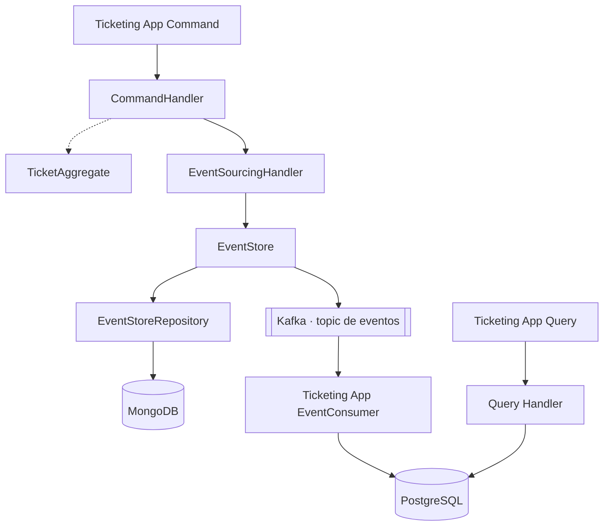
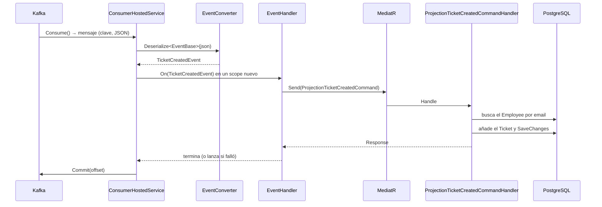

# El consumidor de Kafka y la proyección

[← Volver al README](../../README.md) · [Arquitectura de Query](arquitectura.md) · [Mensajería con Kafka](../mensajeria-kafka.md)

Cómo `Ticketing.Query` recibe los eventos que publica `Ticketing.Command` y los convierte en filas de
PostgreSQL. Es la mitad del proyecto que cierra el círculo del CQRS: la escritura termina en Kafka y la lectura
empieza ahí.

> **Estado.** El código compila, pero el flujo completo (Command publica → Kafka → Query proyecta en
> PostgreSQL) **no se ha probado de extremo a extremo**. Las secciones [*Qué falta*](#qué-falta) y
> [*Cómo probarlo*](#cómo-probarlo) dicen qué hay que hacer antes de darlo por bueno.

## La idea de partida

El proyecto sigue el diseño que se explica en el curso, que separa escritura y lectura y las une con un topic:

Cada caja del esquema tiene su clase en el repositorio:

| Pieza del esquema | Clase real | Servicio |
|---|---|---|
| Command Handler | `TicketCreateCommandHandler` | Command |
| Ticket Aggregate | `TicketAggregate` y `TicketAggregateService` | Command |
| Sourcing Handler | `EventSourcingHandler<T>` | Command |
| Event Store y su repositorio | `EventStore` y `EventModelRepository` | Command |
| MongoDB | colección `eventStore` | Command |
| Topic | `KafkaTopics.TicketEvents` | Common |
| Event Consumer | `ConsumerHostedService` | Query |
| Query Handler | `ReadTicketCommandHandler` (sin implementar) | Query |
| PostgreSQL | `TicketDbContext` | Query |

Lo importante del diseño es que **Query nunca lee MongoDB**. Si necesita un dato de Command, lo recibe como
evento y lo guarda en su propio modelo. Eso da independencia, pero la consistencia pasa a ser **eventual**: entre
que el evento se publica y el consumer lo proyecta hay un hueco en el que `ReadTicket` aún no lo ve.

## El recorrido de un evento

Paso a paso:

1. **`Consume()`** bloquea el hilo hasta que llega un mensaje. El valor es el JSON del evento, que el productor
   de Command serializó con su tipo concreto.
2. **`EventConverter`** lee el campo `Type` del JSON (un número, el valor del enum `eEventType`) para saber a
   qué clase deserializar: `TicketCreatedEvent` o `TicketUpdatedEvent`. Es un conversor polimórfico: el JSON no
   dice "soy un `TicketCreatedEvent`" de forma que .NET lo entienda solo, así que se lo explicamos nosotros.
3. **Un `IServiceScope` por mensaje.** El consumer es de vida larga (singleton), pero el `DbContext` y los
   repositorios son `Scoped`. Si se usaran directamente, un único `DbContext` viviría para siempre y acumularía
   estado. Con un scope por mensaje cada evento trabaja con un contexto limpio.
4. **`EventHandler`** (en `Application`) traduce el evento a un `ProjectionTicketCreatedCommand` y lo envía por
   MediatR. Es el mismo patrón que el resto de la aplicación: el consumer no sabe de bases de datos, solo
   entrega eventos.
5. **`ProjectionTicketCreatedCommandHandler`** hace la proyección: busca al empleado, le añade el ticket y
   guarda.
6. **`Commit`** confirma el offset en Kafka. Hasta ese momento, si el proceso cae, Kafka volvería a entregar el
   mensaje.

## Conceptos de Kafka que usa este código

| Concepto | Qué significa aquí |
|---|---|
| **Consumer group** (`GroupId = TK_CONSUMER`) | Kafka guarda, por grupo, hasta dónde se ha leído. Dos instancias de Query con el mismo grupo se repartirían las particiones; con grupos distintos, cada una recibiría todos los mensajes. |
| **Offset** | La posición de un mensaje dentro de una partición. Es el "marcador" de lectura. |
| **Commit manual** (`EnableAutoCommit = false`) | El offset se confirma a mano, **después** de proyectar. Si se confirmara antes y el handler fallara, el evento se perdería. |
| **`AutoOffsetReset = Earliest`** | Si el grupo no tiene offset guardado (primera vez), lee desde el principio del topic. Útil para reconstruir el modelo de lectura. |
| **`AllowAutoCreateTopics = false`** | El consumer no crea topics: si el topic no existe, falla al suscribirse. Lo crea el productor al publicar el primer evento. |
| **Entrega "al menos una vez"** | Como el commit va después de procesar, un fallo entre las dos cosas provoca un reproceso. Por eso la proyección debería ser **idempotente** (ver [*Qué falta*](#qué-falta)). |

## Las piezas

### `ConsumerHostedService` (Infrastructure)

Implementa `IHostedService`, que es el contrato de .NET para código que vive mientras vive la aplicación.

- **`StartAsync`** crea un `CancellationTokenSource`, lanza el bucle con `Task.Run` y **vuelve enseguida**. Esto
  es lo importante: el host espera a que `StartAsync` termine antes de seguir arrancando (por ejemplo, antes de
  levantar el servidor web). Si el bucle estuviera dentro de `StartAsync`, la API nunca terminaría de arrancar.
- **`StopAsync`** cancela el token y espera a que el bucle acabe, para cerrar el consumer con orden.
- **El bucle** está en `ConsumeAsync`: lee, convierte, procesa y confirma. Al recibir la cancelación, sale por
  `OperationCanceledException` y el `finally` llama a `consumer.Close()`, que avisa a Kafka de que el consumer
  abandona el grupo para que reasigne sus particiones sin esperar a un tiempo de espera.

### `EventConverter` (Infrastructure)

`JsonConverter<EventBase>`. Solo se aplica a `EventBase`, no a sus subclases: si se aplicara también a
`TicketCreatedEvent`, al deserializarla se llamaría a sí mismo sin parar. Solo sabe leer; `Write` lanza
`NotSupportedException`.

### `EventHandler` y la proyección (Application)

`EventHandler` implementa `IEventHandler` (interfaz en `Domain`) y orquesta: un método `On` por tipo de evento.
Si la proyección devuelve un `Response` fallido, **lanza una excepción** para que el consumer no confirme el
offset y el evento no se pierda en silencio.

`ProjectionTicketCreatedCommandHandler`:

1. Comprueba que el `Id` del evento es un `Guid` válido.
2. Busca al `Employee` por email (el `UserName` del evento). Si no existe, devuelve `NotFound`.
3. Crea el `Ticket` y lo añade a la colección del empleado.
4. Marca el empleado con `UpdateAsync` y confirma con `SaveChangesAsync` del Unit of Work.

No lleva `try/catch`: si algo lanza, la excepción llega al consumer.

### Registro en DI

| Qué | Dónde |
|---|---|
| `ConsumerConfig` (enlazado desde `appsettings`, validado al arrancar) y `AddHostedService<ConsumerHostedService>()` | `Infrastructure/ConfigurationServices.cs` |
| `AddMediatR`, validadores y `IEventHandler` | `Application/ConfigurationServices.cs` |

`ConsumerConfig` se enlaza con `Bind` a una instancia y se registra como singleton porque el consumer lo pide
directamente en el constructor. Si faltan `BootstrapServers` o `GroupId`, la API no arranca.

## El topic: un nombre compartido

Productor y consumidor tienen que usar exactamente el mismo topic. Por eso el nombre es una constante en
`Ticketing.Common` (`KafkaTopics.TicketEvents`) y no una clave de configuración en cada servicio. Si cada uno lo
leyera de su `appsettings`, se podrían desincronizar sin que nada fallara: el consumer se suscribiría a un topic
vacío. El precio es que cambiar el nombre obliga a recompilar los dos servicios.

## Los empleados ya existen

El diseño del curso no incluye ningún flujo que cree empleados: el consumer solo **añade tickets** a empleados
que ya están en PostgreSQL. Por eso el handler busca al empleado por email y, si no está, falla. Para probar el
flujo hay que tener al menos un empleado cargado (ver [*Cómo probarlo*](#cómo-probarlo)).

## Qué falta

Lo que sigue pendiente, en orden de importancia:

| Pendiente | Por qué importa |
|---|---|
| **Política de errores del consumer** | Hoy cualquier excepción detiene el bucle. Con un empleado inexistente o un JSON inválido, el consumer queda parado y, al reiniciar, vuelve a leer el mismo mensaje y a fallar. Como no hay nadie esperando la tarea del bucle, solo queda constancia en el log. |
| **Idempotencia** | Si el proceso cae entre proyectar y confirmar, el evento se reprocesa y el ticket se duplica. Hace falta detectar que ya se proyectó, por ejemplo comprobando el id del evento. |
| **`On(TicketUpdatedEvent)`** | Lanza `NotImplementedException`. No se alcanza hoy porque Command solo crea tickets. |
| **Migración** | La migración `Initial` no refleja el modelo actual (ver [*Arquitectura de Query*](arquitectura.md#migraciones)). |
| **Validador de la proyección** | `ProjectionTicketCreateValidator` está registrado pero vacío, y no hay `ValidationBehaviour` en el pipeline de MediatR de Query. |
| **Semántica de `TicketType` y `TicketTypeId`** | `TicketType` guarda un `eEventType`, que solo vale `TicketCreatedEvent` o `TicketUpdatedEvent`. `TicketTypeId` guarda el id del evento, sin clave foránea. Los nombres no reflejan ese contenido. |
| **Arranque sin Kafka** | Si el broker no está o el topic no existe, el consumer falla al suscribirse. No hay reintento. |
| **`JsonSerializerOptions` por mensaje** | Se crea uno nuevo en cada iteración. Funciona; reutilizar una instancia sería más eficiente. |
| **Tests** | `Ticketing.Query.UnitTest` solo tiene el test vacío de la plantilla. El `EventConverter` es lo más sencillo de cubrir primero. |
| **`ReadTicket`** | El handler lanza `NotImplementedException`: no hay todavía lectura. |

## Cómo probarlo

Con el compose levantado (ver [*Entorno local*](../entorno-local.md)):

1. Cargar un empleado en PostgreSQL cuyo `Email` sea el `userName` que se enviará al crear el ticket. El
   handler compara las dos cadenas tal cual.
2. Arrancar `Ticketing.Command` y `Ticketing.Query`.
3. Hacer `POST` a `CreateTicket` en Command con ese `userName`.
4. Comprobar en PostgreSQL que aparece una fila en `tickets` y su relación en `ticket_employees`.

Si el consumer se detiene, el motivo está en el log de `Ticketing.Query`.
